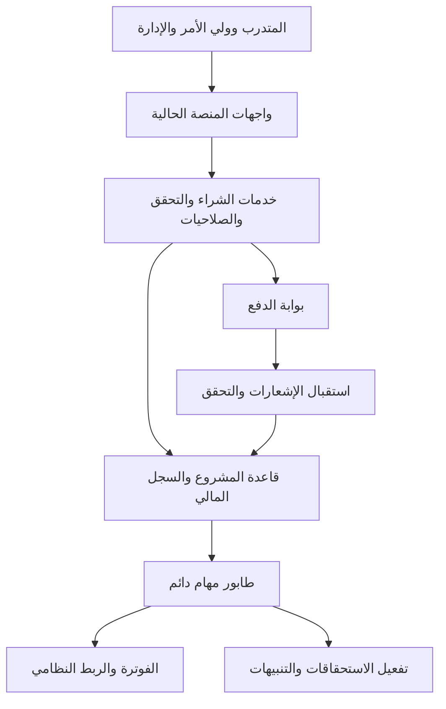

# مشروع إدارة الشراء والمدفوعات والفوترة الإلكترونية
## ملحق تنفيذي لمشروع «تطوير منصة معهد سما القدرات»

- الجهة: مركز سما القدرات.
- الإصدار: 1.4 — 12 نوفمبر 2026، بتوقيت الرياض.
- صيغة التسليم: وثيقة Markdown شاملة للمطور أو وكيل البرمجة؛ تتضمن المواصفات وعقود الربط والاختبارات.
- حالة التسليم: تصميم تنفيذي قابل للبناء والدمج، وليس برنامجًا منشورًا أو شهادة امتثال ضريبي.
- النطاق: وحدة مالية مرتبطة بمنصة التسجيل والحضور القائمة، مع متجر عام وسلة للزوار والمستخدمين وشراء قبل إنشاء الحساب، دون إنشاء هوية متدرب موازية.
- العملة الأساسية: الريال السعودي؛ الحساب الداخلي بالهللات.

> تعليمات التنفيذ: اقرأ هذه الوثيقة كاملة، ثم افحص المشروع القائم واربط الكيانات المنطقية بأسماء الجداول والحقول الفعلية. لا تستبدل منصة المعهد، ولا تحذف سجلاتها، ولا تعِد إنشاء حسابات المتدربين. أي قيمة بين `{{...}}` متغير يجب ربطه أو تعبئته، وليست قيمة صالحة للتشغيل. القيم `null` تعني «غير محدد»، ولا تعني صفرًا أو إعفاءً أو موافقة ضمنية.

> تحديث ملزم في الإصدار 1.2 والمحفوظ في 1.4: لكل طلب شراء رقم فريد دائم ومراجعة إلزامية من مسؤول النظام. كل ذكر سابق للتفعيل أو إرسال رابط استلام الخدمة بعد الدفع مشروط كذلك بموافقة المسؤول السارية. تفاصيل الفصل بين السداد والمراجعة في القسم 41.

## 1. الهدف والنتيجة المطلوبة

إتاحة رحلة مالية متصلة تبدأ باختيار البرنامج والباقة، وتمر بإنشاء الطلب والدفع والتحقق والفوترة، وتنتهي بإتاحة الخدمات المستحقة في حساب المتدرب. تدعم الوحدة ولي الأمر كدافع، تعدد البرامج، الأقساط، الترقية، التحويل البنكي، الاستردادات والمطابقة المالية.

المخرجات البرمجية المطلوبة عند تنفيذ الوثيقة: واجهات مالية عربية RTL، خدمات خلفية موثقة، ربط بمصدر بيانات المشروع، تكامل دفع وفوترة، مهام معالجة وإعادة محاولة، سجل تدقيق، واختبارات قبول. لا تكفي واجهات تعرض بيانات وهمية أو تخزن التحصيل في المتصفح.

## 2. ما استفدنا منه من المشروع القائم وحدود التحقق

استُعيد سياق العمل السابق للمشروع: توجد منصة HTML للتسجيل والحضور، وتشمل البرامج والمتدربين والباقات والدفعات والشهادات والتقارير، مع ذكر استخدام Supabase وتخزين محلي. الاتجاه المعتمد هو تطوير القائم تدريجيًا، والتحقق المركزي من الهوية والحضور، وملف دائم للمتدرب مع تسجيلات متعددة.

لم تُتح نسخة المصدر الحالية أو مخطط قاعدة البيانات الفعلية في هذه الجلسة. ولم يظهر مشروع مطابق بالاسم في قائمة المواقع المتاحة. لذلك لا تُعد أسماء الكيانات أو المسارات الواردة لاحقًا إثباتًا لوجودها حاليًا؛ إنها عقد تنفيذ يُطابق مع الموجود. لا تُنقل أي بيانات أو مفاتيح من مشروع المدارس أو مشروع آخر إلى المعهد.

الرابط المختصر المقدم `https://share.google/g6FTzmWoR5m2oLNHc` تعذر فتحه بأداة البحث. استُخدم موقع المركز المعروف `https://smaalgodrat.com/classes` وصفحات تفاصيل باقاته مصدرًا للأسعار المنشورة. لا يعادل الاطلاع العام فحص قاعدة بيانات الموقع أو بوابة الدفع القائمة.

## 3. الباقات والأسعار المنشورة

المصدر: صفحات المركز العامة، اطلع عليها في 12 نوفمبر 2026. هذه بيانات تهيئة أولية، ويظل سجل الأسعار الفعلي بعد مطابقته هو مصدر التشغيل.

| الرمز المقترح | الباقة | المبلغ الابتدائي المنشور بالريال | الأقساط التالية | الإجمالي الحسابي بالريال | المصدر |
|---|---|---:|---|---:|---|
| BASIC | الأساسية | 490 | لا أقساط مذكورة | 490 | [قائمة الباقات](https://smaalgodrat.com/classes) |
| SILVER | الفضية | 490 | قسطان، كل منهما 150 | 790 | [تفاصيل الفضية](https://smaalgodrat.com/class-details/الباقة-الفضيةرسوم-التسجيل-490قسطين-شهرية-150-ريال) |
| GOLD | الذهبية | 490 | أربعة أقساط، كل منها 150 | 1090 | [تفاصيل الذهبية](https://smaalgodrat.com/class-details/الباقة-الذهبية-رسوم-التسجيل-4904اقساط-شهرية-150-ريال) |
| DIAMOND | الماسية | 490 | ستة أقساط، كل منها 150 | 1390 | [تفاصيل الماسية](https://smaalgodrat.com/class-details/الباقة-الماسية-رسوم-التسجيل-490-6اقساط-شهرية-150-ريال) |

الإجماليات مشتقة من الجمع وليست أسعار دفع نقدي مستقلة وردت بالموقع. لا تُضف رسوم التسجيل مرة أخرى فوق هذه الإجماليات. لم يتضح شمول الضريبة أو وجود خصم للسداد الكامل أو مواعيد استحقاق الأقساط؛ تُربط هذه الحقول ببيانات المعهد قبل التحصيل.

أظهرت القائمة أن الأساسية غير متاحة، وأظهرت صفحة تفاصيلها أن المواعيد ستحدد لاحقًا؛ تُهيأ بحالة `pending_review` ولا تُفتح تلقائيًا للبيع. في الذهبية والفضية ظهرت أرقام ساعات في العداد تختلف عن الوصف؛ لا نستورد عدادات الساعات آليًا. تُحدد المدة والمواعيد والسعة من جدول دفعات التدريب الفعلي.

سجل التهيئة المقترح، بالهللات:

```yaml
catalog_seed:
  source_url: https://smaalgodrat.com/classes
  observed_at: '2026-11-12'
  seed_status: pending_database_match
  currency: SAR
  price_tax_mode: null  # inclusive | exclusive | not_applicable؛ يحدد محاسبيًا
  plans:
    - code: BASIC
      initial_minor: 49000
      installment_count: 0
      installment_minor: 0
      advertised_total_minor: 49000
      availability: pending_review
    - code: SILVER
      initial_minor: 49000
      installment_count: 2
      installment_minor: 15000
      advertised_total_minor: 79000
      availability: pending_database_match
    - code: GOLD
      initial_minor: 49000
      installment_count: 4
      installment_minor: 15000
      advertised_total_minor: 109000
      availability: pending_database_match
    - code: DIAMOND
      initial_minor: 49000
      installment_count: 6
      installment_minor: 15000
      advertised_total_minor: 139000
      availability: pending_database_match
```

## 4. مبادئ لا يجوز كسرها

1. متدرب واحد بمعرف داخلي ثابت؛ السجل المدني وسيلة مطابقة حساسة وليست كلمة مرور.
2. المستفيد والدافع والمشتري المحاسبي قد يكونون أشخاصًا مختلفين؛ يُحفظ كل دور صراحة.
3. تسجيل مستقل لكل برنامج/دفعة؛ تعدد الباقات لا ينشئ حساب متدرب جديدًا.
4. أسعار الطلب وخصوماته وضريبته وسياساته تُحفظ كلقطة ثابتة عند التأكيد.
5. الخادم يحسب المبلغ ويتحقق من الاستحقاق؛ لا يعتمد السعر القادم من المتصفح.
6. نجاح الدفع لا يُستنتج من رابط العودة أو صورة إيصال.
7. الفاتورة والدفعة والتسجيل حالات مستقلة مترابطة؛ تعثر واحدة لا يمحو الأخرى.
8. تكرار الإشعارات أو إعادة الطلب لا يؤدي لتحصيل أو تسجيل أو فوترة مكررة.
9. السجلات المالية الصادرة لا تُحذف؛ التصحيح بعملية عكس أو مستند مرتبط مناسب.
10. الترقية لا تمحو الحضور أو الاختبارات أو الشهادات أو أثر المدفوعات السابقة.
11. استحقاق الدفعات ليس هو إثبات إيراد محاسبي؛ التقارير تميز الالتزام والتحصيل والإيراد.
12. لا تعمل عمليات الدفع أو الترقية أو اعتماد الإيصالات دون اتصال بالمصدر المركزي.

## 5. المعمارية المقترحة



المصدر المركزي هو المرجع للهوية والمدفوعات والصلاحيات. يجوز للواجهة الاحتفاظ بمسودة غير حساسة أو نسخة عرض مؤقتة، ويُظهر انقطاع الاتصال بوضوح. لا يستعيد المتصفح حالة «مدفوع» قديمة فوق الحالة المركزية الأحدث.

التكامل مع البوابات عبر محولات مستقلة `PaymentAdapter` و`InvoiceAdapter` لتغيير المزود دون إعادة بناء التسجيل. لا يُفترض أن الكيان المسمي «Invoice» في بوابة الدفع يفي تلقائيًا بمتطلبات الفاتورة الضريبية.

## 6. سجل المتغيرات وخريطة الربط

لكل متغير سجل: `key, value_or_secret_ref, source, required_for, validation_status, checked_at`. الحقول غير المعروفة تمنع الميزة التابعة لها فقط؛ لا توقف بقية النظام ولا تُستبدل بأرقام وهمية.

| المجموعة | المتغيرات | المصدر المطلوب | شرط التفعيل |
|---|---|---|---|
| المشروع | `{{PROJECT_ID}}`, `{{APP_ORIGIN}}`, `{{API_BASE_URL}}` | إعدادات المشروع الحالي | قبل تكامل الواجهات |
| قاعدة البيانات | `{{DATABASE_CONNECTION_SECRET_REF}}`, `{{DB_SCHEMA}}` | مخزن أسرار وإعدادات الخادم | لا تُكتب كلمة المرور في MD |
| الهوية | `{{AUTH_PROVIDER}}`, `{{AUTH_SUBJECT_FIELD}}`, `{{LEARNER_TABLE}}`, `{{LEARNER_PK}}` | المصدر الفعلي | مطابقة الهوية |
| البرامج | `{{PROGRAM_TABLE}}`, `{{COHORT_TABLE}}`, `{{ENROLLMENT_TABLE}}` | المخطط الفعلي | قبل البيع |
| الباقات | `{{PLAN_TABLE}}`, `{{PLAN_PRICE_TABLE}}`, `{{PLAN_FEATURES_TABLE}}` | كتالوج المشروع | قبل التسعير |
| الحضور | `{{SESSION_TABLE}}`, `{{ATTENDANCE_TABLE}}`, `{{ATTENDANCE_ELIGIBILITY_SERVICE}}` | منصة الحضور القائمة | قبل ربط الاستحقاق |
| الأدوار | `{{ROLE_ASSIGNMENTS_TABLE}}`, `{{GUARDIAN_LINKS_TABLE}}` | نظام الصلاحيات | تحقق خادمي |
| الفوترة | `{{INVOICE_PROVIDER}}`, `{{INVOICE_API_BASE}}`, `{{INVOICE_API_SECRET_REF}}` | مزود الفوترة/الربط المباشر | اختبارات تكامل |
| الدفع | `{{PAYMENT_PROVIDER}}`, `{{PAYMENT_PUBLIC_KEY}}`, `{{PAYMENT_SECRET_REF}}`, `{{WEBHOOK_SECRET_REF}}` | حساب تجاري باسم المركز | تحقق واختبار |
| الجهة | `{{LEGAL_NAME_AR}}`, `{{COMMERCIAL_REGISTRATION}}`, `{{LEGAL_ADDRESS}}`, `{{VAT_NUMBER}}` | سجل المعهد الرسمي | صحة بيانات الفاتورة |
| الضريبة | `{{VAT_REGISTERED}}`, `{{TAX_PROFILE_ID}}`, `{{PRICE_TAX_MODE}}`, `{{ZATCA_PHASE}}` | إعدادات معتمدة محاسبيًا | قبل التحصيل الحقيقي |
| السياسات | `{{REFUND_POLICY_VERSION}}`, `{{UPGRADE_POLICY_VERSION}}`, `{{INSTALLMENT_POLICY_VERSION}}` | سياسات المشروع | عرضها وقبولها |
| التواصل | `{{NOTIFICATION_PROVIDER}}`, `{{SUPPORT_CONTACT}}` | إعدادات المشروع | اختبار القوالب |

تُستكمل خريطة التنفيذ التالية بعد فحص المشروع؛ أي خانة فارغة تعني «لم تُفحص»:

| الكيان المنطقي | الجدول الفعلي | المفتاح الأساسي | حقل الربط | نطاق الوصول | القرار |
|---|---|---|---|---|---|
| learner | `{{...}}` | `{{...}}` | مستخدم المصادقة | صاحب الملف/المخول | إعادة استخدام |
| program/cohort | `{{...}}` | `{{...}}` | البرنامج/الدفعة | العام المنشور/الإدارة | إعادة استخدام |
| enrollment | `{{...}}` | `{{...}}` | المتدرب والدفعة | المستفيد/ولي مرتبط | توسيع الموجود |
| plan/price | `{{...}}` | `{{...}}` | البرنامج والإصدار | منشور للعرض | مطابقة الكتالوج |
| payment | `{{...}}` | `{{...}}` | الطلب/القسط | المالية/صاحب العملية | ترحيل أو توسيع |
| invoice | `{{...}}` | `{{...}}` | البيع/مستند التعديل | المالية/المشتري المخول | إعادة استخدام إن صالح |
| attendance | `{{...}}` | `{{...}}` | التسجيل والجلسة | وفق الدور | حفظ الموجود |

## 7. الحساب البنكي ووسيلة التواصل — بيانات مقدمة من المستخدم

أكمل المستخدم بيانات الحساب التالية، وحدد «مركز سما القدرات» مسمى النظام واسم المستفيد المعروض في هذه الوثيقة. تُنقل إلى إعدادات المشروع كنصوص للحفاظ على الصفر في بداية رقم الحساب. الاسم هنا اسم المستفيد المقدم من المستخدم؛ لا يستبدل تلقائيًا الاسم القانوني لمُصدر الفاتورة دون مطابقته ببيانات الجهة.

| الحقل | القيمة |
|---|---|
| البنك | البنك الأهلي |
| اسم المستفيد | مركز سما القدرات |
| رقم الحساب | `01400012583008` |
| الآيبان | `SA1210000001400012583008` |
| رقم الجوال المحلي | `0561606878` |
| رقم التواصل الدولي | `+966561606878` |
| الاستخدام | واتساب تواصل واستفسارات ومتابعة إثبات السداد |

```yaml
bank_transfer:
  enabled: false  # يفعّل في المشروع بعد تحقق المسؤول؛ ليست هذه الوثيقة تشغيلًا فعليًا
  accounts:
    - id: '{{BANK_ACCOUNT_ID}}'
      bank_name_ar: 'البنك الأهلي'
      beneficiary_legal_name: 'مركز سما القدرات'
      iban: 'SA1210000001400012583008'
      account_number: '01400012583008'
      currency: SAR
      branch_id: '{{BRANCH_ID}}'
      source: user_provided
      active: false
      verification_status: pending_admin_verification
      verified_at: null
      verified_by: null
contact:
  phone_local: '0561606878'
  phone_e164: '+966561606878'
  whatsapp_number: '966561606878'
  whatsapp_url: 'https://wa.me/966561606878'
  usage: support_and_payment_followup
  automatic_messaging_enabled: false
```

فُحص الآيبان حسابيًا: 24 خانة، ونتيجة MOD-97 تساوي 1. صحة الصيغة لا تثبت ملكية الحساب ولا تعني تحققًا مصرفيًا. اعتماد هذه البيانات في الوثيقة لا ينشئ علامة تحقق مزيفة في النظام؛ يسجل المسؤول التحقق من بيانات الحساب والمستفيد عند التجهيز، ثم يفعّل الوسيلة. يُحفظ إصدار الحساب المعروض مع الطلب لمنع التباس تغيير الحساب مستقبلًا.

زر واتساب يفتح محادثة يختار المستخدم إرسالها، برسالة مجهزة تتضمن رقم الطلب واسمه والمبلغ ووصف البرنامج عند الحاجة. لا يرسل النظام رسالة خارجية تلقائيًا، ولا يعد فتح المحادثة أو إرسال صورة الإيصال تأكيدًا لوصول الأموال. الرابط النصي لا يرفق الإيصال تلقائيًا؛ يرفقه العميل يدويًا أو يرفعه داخل طلبه في المنصة. المراسلة الآلية مستقبلًا تكامل مستقل يحتاج قناة أعمال وصلاحيات وإعدادات فعلية.

قالب الرسالة المقترح:

```text
السلام عليكم، بخصوص طلب الشراء رقم {{ORDER_NUMBER}}.
الاسم: {{BUYER_NAME}}
البرنامج/الخدمة: {{ORDER_SUMMARY}}
المبلغ المحول: {{TRANSFER_AMOUNT_SAR}} ريال.
أرغب في متابعة مطابقة التحويل واعتماد الطلب، وسأرفق إثبات السداد.
```

المسار المرجعي هو رفع الإثبات داخل الطلب ليرتبط برقمه، مع إتاحة واتساب للمساعدة. إذا استلم المسؤول الإثبات عبر واتساب، يضيفه إلى الطلب الصحيح مع المصدر والتوقيت قبل اعتماده، ولا يعتمد الإيصال نفسه لطلبين. يظل تأكيد التحويل والموافقة على الطلب خطوتين موثقتين وفق القسم 41، ولا تُتاح الخدمة لمجرد إرسال الرسالة.

بيانات الربط والهوية والضريبة تُستدعى من المشروع؛ إن لم تكن موجودة، تظل متطلبات تشغيل غير مستوفاة. تعبئة الحساب لا تشغّل التحصيل بالبطاقات أو الربط الضريبي.

## 8. نموذج البيانات المنطقي

الأسماء التالية مقترحة وليست أوامر لإنشاء جداول مكررة. جميع السجلات لها معرف داخلي، وتواريخ إنشاء/تعديل، وإصدار للتزامن عند الحاجة، ومعرف الجهة/الفرع إن كان المشروع متعدد الجهات.

| الكيان | الحقول الأساسية | العلاقات والقيود |
|---|---|---|
| Learner | id, auth_subject, name, identity_type, identity_lookup_hash, encrypted_identity | فريد بحسب نوع الهوية وجهة إصدارها والقيمة المطبعة |
| GuardianLink | guardian_user_id, learner_id, verification_status, scope, revoked_at | علاقة موثقة؛ لا تُستنتج من رقم مدخل |
| BillingParty | id, party_type, name, address, tax_number, contact | بيانات المشتري تختلف عن المستفيد |
| Program / Cohort | id, program_id, starts_at, ends_at, capacity, timezone, sales_status | السعة لكل دفعة فعلية |
| PlanVersion | id, plan_code, program_id, features, duration_rule, published_at | إصدار ثابت لكل تغيير تجاري |
| PriceVersion | id, plan_version_id, currency, initial_minor, total_minor, tax_profile_id, tax_mode, valid_from/to | منع نطاقات أسعار متعارضة |
| Enrollment | id, learner_id, program_id, cohort_id, status, current_plan_version_id | تسجيل نشط واحد للمتدرب والدفعة ما لم يسمح نموذج المشروع بغير ذلك |
| EnrollmentPlanHistory | enrollment_id, old_plan, new_plan, effective_at, change_request_id | تاريخ لا يستبدل |
| Quote | id, beneficiary_id, price_version_id, calculation_snapshot, expires_at, status | ينشئه الخادم؛ نسخة للتقديم |
| Order / OrderLine | id, buyer_id, payer_id, learner_id, quote_id, totals, terms_version, status | خطوط متعددة؛ تخصيص مالي لكل مستفيد/تسجيل |
| SeatReservation | order_line_id, cohort_id, expires_at, status | حجز داخل معاملة لمنع تجاوز السعة |
| InstallmentSchedule | id, order_line_id, contract_version, status | لا يُستبدل الجدول القديم عند الترقية |
| Installment | id, schedule_id, sequence, due_date, amount_minor, status | فريد ضمن الجدول والتسلسل |
| PaymentAttempt | id, order_id, installment_id, provider, provider_payment_id, amount_minor, currency, status, idempotency_key | معرف المزود فريد لكل حساب تاجر/بيئة |
| PaymentAllocation | payment_id, obligation_id, amount_minor | مجموع التخصيصات لا يتجاوز التحصيل القابل للتخصيص |
| BankTransferClaim | id, order_id, receipt_private_path, bank_reference, claimed_amount, review_status | الإيصال طلب تحقق؛ المطابقة على حركة البنك |
| BankStatementLine | bank_account_id, external_transaction_id, date, amount, reconciliation_status | منع تخصيص الحركة البنكية مرتين |
| FinancialDocument | id, type, original_document_id, document_number, uuid, immutable_snapshot, issue_status | مستند أصلي أو تعديل؛ رقم فريد لا يُعاد استخدامه |
| InvoiceSubmission | document_id, provider_request_id, status, attempt_count, response_code, next_retry_at | تتبع الاعتماد/الإبلاغ مستقل عن الإصدار |
| Refund | id, payment_id, amount_minor, reason, status, provider_refund_id, approved_by | لا يتجاوز المتبقي القابل للاسترداد |
| Dispute | id, payment_id, provider_case_id, status, disputed_minor | اعتراضات وعمليات عكس خارجية |
| UpgradeRequest | enrollment_id, quote_id, old_obligations_snapshot, credit_minor, delta_minor, status | تغيير واحد معلق لكل تسجيل |
| Entitlement | enrollment_id, feature_key, starts_at, ends_at, status, source_event_id | فريد لمصدر التفعيل؛ لا يستنتج من الواجهة |
| JournalEntry / JournalLine | id, source_event_id, account_code, debit_minor, credit_minor, currency | قيد متوازن، وتصحيح بقيد عكسي |
| Settlement / SettlementLine | provider, settlement_id, gross, fees, tax_on_fees, net, bank_date | المطابقة حسب تقرير المزود والمصرف |
| WebhookInbox | provider, event_key, payload_digest, received_at, process_status | تخزين دائم ومنع تكرار |
| OutboxJob | event_id, aggregate_id, type, payload, attempts, next_retry_at | يُنشأ مع التغيير المالي في المعاملة نفسها |
| AuditEvent | actor_id, action, entity_id, reason, correlation_id, timestamp | سجل محمي لا يحرره المستخدم |
| PolicyVersion / Consent | version, content_hash, accepted_by, accepted_at, order_id | إثبات الشروط المطبقة وقت البيع |

تُحفظ مرفقات الدفع والفواتير في تخزين خاص؛ روابط التنزيل مؤقتة ومصرح بها. تُحجب الهوية الكاملة عن التقارير العامة والسجلات التقنية. لا تحفظ PAN أو CVV أو كلمات المرور أو المفاتيح في هذه الكيانات.

## 9. الهوية الموحدة وربط ولي الأمر

- يُنشأ معرف داخلي دائم للمتدرب ويُربط بحساب المصادقة الحالي؛ لا يكون السجل المدني مفتاحًا ظاهرًا في الروابط.
- يُطبّع رقم الهوية ويُشفّر؛ تستخدم قيمة مطابقة سرية مشتقة على الخادم عند الحاجة، لا تجزئة غير مملحة قابلة للتخمين.
- تسجيل الدخول يتطلب آلية مصادقة فعلية؛ إدخال هوية طالب لا يفتح صفحته.
- ربط ولي الأمر يتم عبر دعوة/رمز تحقق على قناة موثقة وإثبات العلاقة وفق آلية المشروع. دفع فاتورة طالب لا يمنح الدافع صلاحية الاطلاع الأكاديمي تلقائيًا.
- يمكن لولي واحد الارتباط بعدة متدربين؛ نطاق العرض لكل علاقة وصلاحية، مع إلغاء الوصول عند سحب الربط.
- تعرض صفحة المتدرب تبويبات البرامج، وداخل كل برنامج الباقة والاستحقاق والحضور والتقدم والمستحقات المرتبطة.
- الحضور مرتبط بالجلسة والتسجيل؛ عند شراء برنامج جديد لا تُنسخ نسب الحضور تلقائيًا إلى البرنامج الجديد.

## 10. رحلة الشراء من البداية للنهاية

1. يجلب الكتالوج المنشور وخيارات الدفعات من المصدر المركزي.
2. يتيح المتابعة بحساب مسجل أو بصفة زائر. للزائر جلسة شراء محدودة وبيانات تواصل متحقق منها، دون اشتراط إنشاء حساب كامل. إن اختير مستفيد قائم، يتحقق من صلاحية التصرف عليه. راجع الأقسام 33–40.
3. يمنع شراء باقة موجودة للتسجيل نفسه، ويقترح الترقية بدل شراء مكرر.
4. ينشئ عرض سعر قصير الصلاحية على الخادم؛ يثبت الباقة والسياسات والضريبة والخصم ومواعيد الأقساط.
5. يعرض «المطلوب الآن» و«الإجمالي» و«المتبقي» و«تواريخ الاستحقاق» كلًا على حدة.
6. يقبل المشتري الشروط ذات الإصدار المحدد، ثم ينشأ الطلب والحجز مؤقتًا.
7. ينشئ الخادم محاولة دفع للمبلغ المستحق الآن فقط، بمفتاح عدم تكرار.
8. تنفذ بوابة الدفع إدخال البطاقة والتحقق؛ لا تمر بياناتها الخام عبر مخزن المنصة.
9. تظهر العودة بحالة «جارٍ التحقق» حتى يتأكد الخادم من المزود.
10. يحفظ التحصيل المؤكد ويخصصه للاستحقاق ويسجل الحدث المالي مرة واحدة.
11. يحفظ حق الخدمة المدفوعة وتُجدول الفوترة والتنبيهات من طابور دائم. للمستخدم الموثق يُفعّل التسجيل وفق سياسة الدفعة الابتدائية؛ وللزائر الجديد يحفظ استحقاق مدفوع بانتظار إكمال الهوية، ويُرسل رابط آمن لربطه بحساب جديد أو قائم، ثم يُفعّل التسجيل دون دفع ثانٍ.
12. تظهر النتيجة في متابعة الطلب للزائر بنطاق محدود، ثم في حساب المستفيد وصفحة الدافع المخول ولوحة الإدارة. يمكن استعادة الطلب بعد إغلاق المتصفح بآلية موثقة، دون اشتراط بقاء تبويب الدفع مفتوحًا.

عند انتهاء حجز المقعد ووصول تحصيل متأخر، يتحقق الخادم من السعة قبل التفعيل. إن لم يوجد مقعد: يحفظ المال بحالة استثناء، ويعرض معالجة بدفعة بديلة أو استرداد وفق السياسة؛ لا يتجاوز السعة ولا يُضيع الدفع.

## 11. حساب الأسعار والضريبة والخصومات

كل الحسابات الصحيحة بوحدات العملة الصغرى. تستخدم قواعد التقريب المعتمدة للفواتير ويُختبر التطابق بين مجموع البنود والإجماليات. لا تستخدم أعداد الفاصلة العائمة لحساب الأموال.

```text
السعر المتفق عليه = لقطة السعر السارية عند تأكيد العرض
صافي البنود = سعر البنود - الخصومات الموزعة على البنود
إجمالي العقد = صافي البنود + الضريبة (إن كان السعر غير شامل)
المطلوب الآن = الاستحقاقات الحالية - المدفوعات المخصصة لها - الأرصدة المطبقة
رصيد العقد = الالتزامات المعدلة - التحصيل المخصص + المبالغ المستردة ذات الصلة
```

- عند السعر الشامل تُستخرج الضريبة وفق الفئة، ولا تُضاف مجددًا. السعر غير الشامل يعرض الإجمالي النهائي قبل الدفع.
- الملف الضريبي لكل خدمة يحدد الفئة والنسبة وسبب الاستثناء/الإعفاء إن وجد وتاريخ السريان؛ لا يكفي متغير نسبة واحد لكل الحالات.
- `VAT_REGISTERED=false` لا يعني فرض ضريبة صفرية على أنها ضريبة محصلة؛ يُطبّق نموذج مستند الجهة المناسب.
- لا يُفترض تحمل الدولة أو الإعفاء اعتمادًا على جنسية المتدرب أو وصف «تعليمي» وحده.
- الكوبون له مدة وحد وعدد استخدامات ونطاق برامج وباقات وحد لكل مستفيد وقاعدة جمع مع العروض.
- حجز استخدام الكوبون والتحرير عند الفشل، ثم استهلاكه عند التأكيد، تتم ذريًا.
- لا يمكن لخصم أن يجعل المستحق سالبًا؛ الطلب الصفري يمر بمسار اعتماد مجاني موثق دون محاولة بطاقة وهمية.
- تحفظ لقطة الضريبة والخصم حتى لو تغيرت الأسعار أو الكوبونات مستقبلًا.

## 12. الأقساط والدفعات المقدمة

جدول الأقساط التزام مالي على المعهد والمتدرب؛ لا يعني وجود تفويض بالسحب التلقائي. لا يُفعّل السحب الدوري إلا إذا دعمه مزود الدفع والحساب التجاري ووجد تفويض صريح صالح.

متغيرات السياسة:

```yaml
installments:
  due_rule: '{{MONTHLY_FROM_ENROLLMENT_OR_FIXED_DATES}}'
  first_due_date: '{{FROM_ACTUAL_SCHEDULE}}'
  month_end_rule: last_valid_day
  reminder_offsets_days: '{{FROM_POLICY}}'
  grace_days: '{{FROM_POLICY}}'
  access_on_overdue: '{{WARN_OR_LIMIT_NEW_ACCESS}}'
  keep_historical_records_visible: true
  automatic_debit: false
  early_payoff_discount: null
  late_fee: null
```

لا تُنشأ غرامة تأخير افتراضية. يُظهر النظام مواعيد حقيقية قبل إتمام العقد؛ إذا لم تتوفر فلا يفتح عرض الأقساط للبيع. يُحفظ التاريخ المحلي للاستحقاق بتوقيت الرياض مع الطابع الزمني UTC للأحداث. آخر يوم من الشهر يعالج بقانون موثق لا بانزلاق الأشهر.

يُسمح بسداد قسط أو عدة أقساط أو الرصيد الكامل؛ توزع الدفعة وفق ترتيب معلن مع قفل السجلات. الدفعة الجزئية تنتج رصيدًا متبقيًا واضحًا ولا تجعل القسط مدفوعًا بالكامل.

الفوترة منفصلة عن جدول التحصيل: لا تُصدر فاتورة كاملة ثم فواتير بيع أخرى لكل قسط فتضاعف المبيعات والضريبة. تُحدد سياسة الفوترة بحسب التوريد ونقطة الاستحقاق والمعالجة المعتمدة. عند انطباق الدفعات المقدمة يصدر مستندها وتُسوّى في الفاتورة اللاحقة مع المراجع اللازمة؛ سند القبض وحده ليس بديلًا عامًا. المرجع الفني [معيار XML للهيئة](https://www.zatca.gov.sa/ar/E-Invoicing/SystemsDevelopers/Documents/20220624_ZATCA_Electronic_Invoice_XML_Implementation_Standard_vF.pdf).

## 13. التحويل البنكي والنقد ونقاط البيع

- التحويل: ينشأ رقم طلب مرجعي وتظهر بيانات الحساب المعتمد والمبلغ المطلوب؛ يرفع الدافع إثباتًا في تخزين خاص.
- الفحص: نوع الملف وحجمه ومحتواه، وفحص المرفقات قبل المعاينة؛ لا تنفذ صور أو ملفات كصفحات HTML.
- يعتمد المحاسب بعد مطابقة حركة البنك والمبلغ والعملة والمرجع والمستفيد. OCR أو صورة الإيصال أدوات مساعدة لا دليل تحصيل نهائي.
- يحجز تخصيص حركة البنك لمنع اعتماد نفس التحويل لطلبين. قد يدفع تحويل واحد عدة التزامات بتخصيصات لا تتجاوز قيمته.
- الزيادة تحفظ رصيدًا غير مخصص للعميل أو تعاد وفق السياسة؛ لا تزيد سعر البرنامج آليًا.
- النقص يظل جزئيًا؛ التفعيل يتبع حد الدفعة الأولية المتفق عليه.
- النقد ونقاط البيع، إن كانا مفعلين فعليًا، يتطلبان موظفًا مخولًا ومرجع العملية والصندوق/الجهاز والمطابقة اليومية.
- أي رفض يوضح السبب ويتيح إعادة تقديم إثبات جديد مع حفظ الإثبات السابق في السجل.

## 14. الترقية بين الباقات دون فقد البيانات

الترقية تعديل تعاقدي على التسجيل القائم في البرنامج نفسه. لا يُنشأ ملف متدرب جديد ولا تُعاد نسبة تقدمه إلى الصفر. لا يسمح بتغييرين ماليين متزامنين على التسجيل نفسه.

يلزم تعريف: الباقات المسموح الانتقال بينها، نطاق احتساب المبلغ السابق، الاستهلاك، الرسوم إن وجدت، معالجة الأقساط المعلقة، تاريخ بدء المزايا الجديدة، والتعديل الضريبي. القيم تأتي من `{{UPGRADE_POLICY_VERSION}}` ولا تستنبط من فروق الأسعار وحدها.

### 14.1 سياسة تهيئة مقترحة قابلة للاعتماد في المشروع

للباقات المنشورة، يمكن اعتماد «استبدال الالتزام الكلي داخل رحلة واحدة مع احتساب التحصيل السابق المؤهل» دون إعادة تحصيل 490 ريالًا. هذه سياسة تصميم مقترحة وليست سياسة معلنة للمركز. تظل غير مفعلة حتى ربطها بالسياسة الفعلية.

```text
T = إجمالي الباقة المستهدفة بعد خصوماتها ومعالجتها الضريبية
C = التحصيل السابق المؤهل للرحلة، بعد طرح ما استرد أو عكس أو استهلك كرصيد سابق
N = الرصيد المطلوب للرحلة بعد الترقية = max(0, T - C)
D = الزيادة في الالتزام = T - الالتزام السابق المعدل
```

المبلغ المطلوب الآن جزء من N يحدده الجدول الجديد، وليس بالضرورة كامل N. الرصيد السابق غير المدفوع لا يحتسب «مدفوعًا». إن كانت السياسة تضيف خدمات فقط أو تستبعد قيمة مستهلكة، تستخدم معادلة مختلفة موثقة لا المعادلة أعلاه.

### 14.2 أمثلة حسابية قبل حسم الضريبة ووفق السياسة المقترحة

| الانتقال | التحصيل السابق المؤهل | إجمالي الهدف | المتبقي بعد الاستبدال | الزيادة في الالتزام |
|---|---:|---:|---:|---:|
| الأساسية إلى الفضية | 490 | 790 | 300 | 300 |
| الفضية المدفوعة بالكامل إلى الذهبية | 790 | 1090 | 300 | 300 |
| الفضية إلى الذهبية، مع سداد 640 فقط | 640 | 1090 | 450 | 300 |
| الذهبية المدفوعة بالكامل إلى الماسية | 1090 | 1390 | 300 | 300 |
| الأساسية إلى الماسية | 490 | 1390 | 900 | 900 |

في مثال 640: المتبقي القديم 150 والزيادة 300، فيصبح المطلوب الكلي 450؛ لا نطلب 300 فقط ولا نضيف الجدول القديم مرة ثانية. لا تحتسب هذه الأمثلة خصومات أو استردادات أو استهلاكًا أو اختلاف فئات الضريبة.

### 14.3 خطوات التنفيذ الذري

1. قفل التسجيل وقراءة العقد والدفعات والاستردادات والمزايا الحالية.
2. بناء عرض ترقية صالح لمدة محدودة مع لقطة للأرصدة وإصدار التسجيل.
3. عرض ما سُدد وما سيُسوّى وما سيلغى من استحقاقات مستقبلية والجدول الجديد.
4. عند قبول العرض، إنشاء طلب ترقية ومحاولة دفع إن لزم؛ يعاد التحقق من الإصدار قبل التطبيق.
5. بعد التحقق، إغلاق الاستحقاقات المستبدلة بحالة `superseded` مع ربطها بالبديل؛ لا تحذف ولا تلغى الفواتير يدويًا.
6. تخصيص الأرصدة مرة واحدة، وإضافة تاريخ الباقة والاستحقاقات الجديدة وحدث الفوترة المناسب في معاملة واحدة.
7. تفعيل المزايا الجديدة، مع بقاء الحضور والتقدم القديمين مرتبطين بتسجيلهما ومحتواهما الأصلي.
8. عند فشل الدفع تبقى الباقة الحالية كما هي. عند تعثر التفعيل بعد التحصيل تعالج مهمة الاستعادة دون دفع جديد.

المحتوى المشترك يحتفظ بإتمامه عبر معرفات المحتوى أو قواعد تكافؤ صريحة؛ لا تُنسخ درجات أو ساعات بين مواد مختلفة. التخفيض إلى باقة أقل طلب مستقل بمراجعة مالية، وليس زرًا يعيد فرق السعر تلقائيًا.

## 15. تعدد البرامج والتسجيل المتكرر

- شراء برنامج مختلف ينشئ تسجيلًا آخر تحت المتدرب نفسه؛ لكل تسجيل عقد وجدول وفواتير وتقدم.
- شراء البرنامج نفسه في دفعة لاحقة إعادة تسجيل مقصودة، مع عرض تنبيه ومدة جديدة، وليس ترقية صامتة.
- البرنامج المدمج من عدة برامج يحدد مكونات الاستحقاق وتوزيع قيمة البيع لتجنب بيع المكون نفسه مرتين أو احتساب إيراده مرتين.
- لا ينتقل رصيد مالي من برنامج لآخر إلا بتخصيص/تسوية مخولة ومثبتة؛ ولا ينتقل الحضور تلقائيًا.
- إذا كانت الشهادة مشروطة بالسداد، تُقرأ القاعدة من سياسة البرنامج، مع فصل تقييم الإتمام الأكاديمي عن الحالة المالية.

## 16. الفوترة الإلكترونية والربط النظامي

يحدد المشروع `{{VAT_REGISTERED}}` و`{{ZATCA_PHASE}}` من حالة المعهد وإشعار الهيئة الفعلي. لا يُدّعى الربط أو الامتثال لمجرد وجود PDF أو QR.

وفق أدلة الهيئة: الفاتورة المبسطة للأفراد غالبًا، والضريبية للمنشآت غالبًا؛ الاختيار الفعلي يتبع نوع المعاملة وبياناتها. في المرحلة الثانية تمر الفاتورة الضريبية بمسار الاعتماد قبل تسليمها، والمبسطة بمسار الإبلاغ خلال 24 ساعة من إصدارها. يطبق المحول متطلبات الصيغة والختم والحقول لكل نوع. [دليل الهيئة التفصيلي](https://www.zatca.gov.sa/en/E-Invoicing/Introduction/Guidelines/Documents/E-Invoicing_Detailed__Guideline.pdf).

متطلبات التنفيذ:

- قالب عربي RTL واضح للعميل، مع بيانات الجهة والمشتري بحسب النوع والبنود والخصومات والفئات الضريبية والمجاميع والمرجع النظامي.
- حفظ XML النظامي والنسخة القابلة للقراءة وردود الربط والمراجع الأصلية بأمان؛ الملف المرئي ليس المصدر الوحيد.
- تسلسل أرقام ثابت، ومعرفات المستند، وسلسلة/عداد وختم عند انطباق المواصفات، تديرها جهة إصدار واحدة دون سباق بين الخوادم.
- عدم عرض «معتمدة من الهيئة» قبل رد الاعتماد؛ توضح حالات الإصدار والإرسال والقبول والرفض بشكل مستقل.
- الفاتورة الضريبية التي لم تعتمد لا تُسلّم كفاتورة نهائية معتمدة؛ يمكن عرض حالة الطلب والتحصيل دون ادعاء اكتمال الفاتورة.
- تنبيهات قبل تجاوز مهلة إبلاغ المبسطة، ومهمة إعادة محاولة مستمرة مع إجراء معالجة عند تعطل الاتصال؛ فشل الاتصال لا يسقط الالتزام النظامي.
- التصحيح بإشعار دائن/مدين أو مستند جديد مرتبط وفق الحالة، مع السبب والمراجع؛ لا تحرير لفاتورة صادرة ولا حذف لها. [دليل الفوترة التفصيلي العربي](https://zatca.gov.sa/ar/E-Invoicing/Introduction/Guidelines/Documents/E-Invoicing-Detailed-Guidelines.pdf).
- عند استخدام مزود خارجي، تحفظ معرفات المستند وردوده ونسخة مؤرشفة قابلة للتصدير، وتمنع المنصة والمزود من إصدار فاتورتين للحدث نفسه.
- سياسات الأرشفة والاحتفاظ `{{FINANCIAL_RETENTION_POLICY}}` تعتمد من الجهة المختصة؛ لا ينفذ حذف آلي قبل تحديدها.

اختبارات المحول تشمل المستندات والسيناريوهات التي تخص المعهد، والتحقق بأدوات الهيئة وبيئة الاختبار، وتهيئة الإنتاج وشهاداته عند انطباقها. إصدار النظام لا يُعد مكتملًا ضريبيًا قبل نجاح ذلك على التكامل الفعلي.

## 17. الحالات والانتقالات

| الكيان | الحالات | القواعد |
|---|---|---|
| العرض | draft, valid, expired, accepted, superseded | لا يُدفع عرض منتهٍ؛ يعاد تسعيره بموافقة العميل |
| الطلب | pending_payment, partially_paid, paid, expired, cancelled, review_required | الطلب المدفوع لا يمحى بسبب إشعار فشل لمحاولة أخرى |
| محاولة الدفع | created, pending, authorized, captured, failed, cancelled, expired | التفويض وحده ليس تحصيلًا؛ حالة المزود تُطبّع عبر المحول |
| التسجيل | pending, active, grace, restricted, completed, cancelled | القيود لا تحذف التاريخ الأكاديمي |
| القسط | scheduled, due, partially_paid, paid, overdue, superseded, cancelled | التأخر مشتق من التاريخ والرصيد |
| المستند | draft, issuance_pending, issued, rejected | عند غموض نتيجة الإصدار يُستعلم قبل إنشاء بديل |
| تقديم المستند | queued, sending, cleared, reported, rejected, retrying | يختار cleared أو reported بحسب النوع |
| الاسترداد | requested, approved, submitted, succeeded, failed, rejected | يحجز الحد القابل للاسترداد من لحظة الإرسال |
| الترقية | quoted, awaiting_payment, applying, completed, expired, failed, review_required | التعديل الفعلي مرة واحدة |

حالة الدفع الصافي `partially_refunded/refunded/disputed` تُشتق من سجل الاستردادات والاعتراضات؛ لا يُمحى التحصيل الأصلي. ترتيب وصول الإشعارات لا يحدد الحقيقة؛ عند التعارض يستعلم الخادم عن حالة العملية المعتمدة.

## 18. منع التكرار والتزامن والتعثر

- مفتاح `Idempotency-Key` لكل أمر مالي؛ يخزن نطاقه وهوية الفاعل وتجزئة جسم الطلب والنتيجة. تكرار المفتاح والجسم يعيد النتيجة نفسها؛ اختلاف الجسم يعيد 409.
- إذا دعم المزود مفتاحًا مماثلًا يستخدمه المحول أيضًا. عند انقطاع الرد بعد إرسال تحصيل/استرداد/فاتورة لا ينشئ عملية ثانية قبل الاستعلام والتسوية.
- الإشعار الوارد يتحقق من توقيعه أو سره بحسب توثيق المزود، ثم يخزن في Inbox دائم؛ يُرسل الرد الناجح بعد التخزين الدائم وقبل الأعمال البطيئة.
- تُراجع العملية مباشرة عبر API المزود، مع المبلغ والعملة وحساب التاجر والبيئة وربط الطلب المحفوظ على الخادم. لا يعتمد وصف قابل لتعديل العميل كإثبات ربط.
- معالجة الأحداث تتم مرة واحدة من منظور الأثر باستخدام قيد فريد ومعاملة؛ لا نفترض تسليم الشبكة مرة واحدة.
- تخصص الدفعة وتحدث الأرصدة ويضاف Outbox في معاملة واحدة. الخدمات الخارجية تنفذ بعدها، لا داخل معاملة قاعدة طويلة.
- تستخدم أقفال/إصدارات لمنع ترقية متزامنة واستردادات تتجاوز المتبقي وتجاوز المقاعد.
- مهمة دورية تطابق العمليات المعلقة مع المزود وتستعيد الإشعارات المفقودة؛ فشل آخر محاولة لا يُسقط طلبًا له تحصيل ناجح سابق.
- إعادة المحاولة بتدرج زمني وعشوائية وحدود، ثم قائمة تدخل مالي، مع تنبيه ومتابعة حتى الإغلاق. مدد التشغيل تضبط من `{{RETRY_POLICY}}`.

شبه كود لمسار التحصيل:

```text
receive(event):
  verify_provider_authentication(event)
  persist_inbox_once(event.unique_key, event.payload_digest)
  acknowledge_after_commit()

process(event):
  payment = provider.fetch(event.payment_id)
  expected = lookup_attempt_server_side(payment.id)
  verify_merchant_environment_order_currency_amount(payment, expected)
  if not payment.is_captured: record_state_without_activation(); return
  transaction:
    lock(expected.order, expected.obligation)
    if capture_already_recorded(payment.id): return
    append_capture_and_balanced_journal()
    allocate_amount_within_obligation()
    append_outbox_for_fulfillment_and_document_workflow()
  worker_retries_outbox_until_effect_applied_once()
```

## 19. الاسترداد والإلغاء والاعتراضات

1. يحدد العميل الطلب والسبب؛ يحسب الخادم الأهلية والقيمة وفق نسخة السياسة المقبولة.
2. يرى الموظف الخدمات المستهلكة والمدفوعات والاستردادات السابقة والقيود قبل الاعتماد.
3. يفصل دور الطلب عن الاعتماد وفق حدود صلاحيات قابلة للضبط.
4. يقفل الرصيد ويحجز مبلغ الاسترداد الجاري لمنع استردادين متزامنين.
5. يرسل للبوابة بنفس معرف الطلب؛ عند النتيجة الغامضة يستعلم ولا يعيد السحب العكسي عشوائيًا.
6. يتابع نجاح الاسترداد فعليًا، ثم يعكس التخصيص/القيد ويحدّث الاستحقاق وفق السياسة ويصدر المستند المالي المناسب.
7. لا تُحذف الشهادة أو الحضور أو الفاتورة الأصلية؛ تحفظ حالات الإلغاء ومراجع التصحيح.
8. رد التحويل البنكي يتم بعد التحقق من المستفيد والحساب واعتماد العملية مع مرجع تحويل فعلي.
9. الاعتراض البنكي أو الاسترجاع القسري يسجل مستقلاً ويوقف الاسترداد الاختياري المتداخل حتى منع رد المال مرتين.
10. إلغاء دفعة تدريب كاملة يولد قائمة متضررين وخيارات نقل أو استرداد وتعديلات فواتير، مع تتبع كل حالة.

## 20. عقود الواجهات البرمجية المقترحة

المسارات التالية منطقية؛ تربط بأسماء خدمات المشروع. الطلبات الخاصة تتضمن جلسة حساب موثقة أو جلسة زائر محدودة بحسب العملية ومعرف ارتباط. الكتالوج المنشور عام؛ ولا تمنح جلسة الزائر وصولًا إلى سجلات الحسابات. يتحقق الخادم من الجهة والمستفيد حيث ينطبق. أوامر المال تستخدم مفتاح عدم تكرار. لا ترسل أرقام بطاقات أو أسرار في هذه الطلبات.

| العملية | المسار | أهم المدخلات | أهم المخرجات/الضوابط |
|---|---|---|---|
| عرض الكتالوج | GET /finance/catalog | program_id, cohort_id | أسعار منشورة وإصدارات وتوافر فقط |
| عرض سعر | POST /finance/quotes | learner_id أو beneficiary_draft_id, plan_id, cohort_id, coupon_code, payment_schedule_choice | quote_id, totals, due_now, dates, expires_at, policies |
| إنشاء طلب | POST /finance/orders | quote_id, buyer_id أو guest_checkout_id, consents | order_id؛ إعادة حساب/تحقق قبل الحفظ |
| بدء الدفع | POST /finance/orders/:id/payment-attempts | obligation_ids, method | رابط/رمز جلسة المزود؛ المبلغ من الخادم |
| متابعة الطلب | GET /finance/orders/:id | لا شيء | حالات الطلب والدفع والفاتورة منفصلة |
| إشعار المزود | POST /integrations/payments/:provider/webhook | الجسم الأصلي والترويسات | تحقق خاص بالمزود لا جلسة مستخدم |
| إثبات تحويل | POST /finance/orders/:id/bank-claims | private_upload_id, reference, date | pending_review؛ لا تفعيل |
| مراجعة تحويل | POST /finance/bank-claims/:id/review | decision, statement_line_id, reason | تخصيص ذري وتدقيق |
| عرض الترقية | POST /finance/enrollments/:id/upgrade-quotes | target_plan_id | مقارنة، رصيد، جدول، انتهاء |
| قبول الترقية | POST /finance/upgrades | quote_id, consent | upgrade_id ومطلوب الدفع |
| طلب استرداد | POST /finance/refund-requests | payment_id, reason, requested_minor | طلب فقط لا تحويل مباشر |
| اعتماد استرداد | POST /finance/refunds/:id/approve | amount_minor, reason | حجز رصيد وإرسال مخول |
| قائمة المستندات | GET /finance/documents | learner_id/enrollment_id | تصفية خادمية حسب الصلاحية |
| تنزيل مستند | GET /finance/documents/:id/download | format | رابط قصير بعد تحقق كل مرة |
| إدارة السعر | POST /finance/price-versions | تفاصيل الإصدار الجديد | لا تغيير طلبات سابقة |
| المطابقة | POST /finance/reconciliation-runs | period, provider/account | نتيجة بالمطابق والفروقات |
| التهيئة | GET /finance/readiness | صلاحية إدارة | مفاتيح مفقودة كأسماء فقط |

مثال استجابة عرض سعر؛ جميع القيم التالية تربط بحساب الخادم:

```json
{
  "quote_id": "{{SERVER_QUOTE_ID}}",
  "currency": "SAR",
  "price_version_id": "{{ACTUAL_PRICE_VERSION_ID}}",
  "beneficiary_id": "{{AUTHORIZED_LEARNER_ID}}",
  "totals": {
    "net_minor": "{{INTEGER}}",
    "discount_minor": "{{INTEGER}}",
    "tax_minor": "{{INTEGER}}",
    "contract_total_minor": "{{INTEGER}}",
    "due_now_minor": "{{INTEGER}}",
    "remaining_minor": "{{INTEGER}}"
  },
  "installments": "{{SERVER_SCHEDULE_ARRAY}}",
  "expires_at": "{{ISO8601}}",
  "policy_versions": "{{POLICY_IDS}}"
}
```

المثال قالب توثيق؛ الحقول النقدية تكون أعدادًا صحيحة فعلية في التنفيذ، لا سلاسل نصية بين أقواس.

## 21. أخطاء مفهومة للمستخدم

| الرمز | النص العربي | الإجراء |
|---|---|---|
| PRICE_CHANGED | تغير السعر؛ راجع الإجمالي الجديد قبل المتابعة | عرض جديد وموافقة جديدة |
| QUOTE_EXPIRED | انتهت صلاحية عرض السعر | إعادة الحساب دون تحصيل |
| ALREADY_ENROLLED | لديك تسجيل في هذه الدفعة | فتح التسجيل/الترقية |
| NO_SEATS | لا توجد مقاعد متاحة في الموعد المحدد | اختيار دفعة أخرى |
| PAYMENT_PENDING | نتحقق من نتيجة الدفع؛ تابع الطلب دون إعادة الدفع الآن | استعلام ومطابقة |
| PAYMENT_FAILED | لم تُؤكد عملية الدفع | متابعة المحاولة بعد التحقق من عدم التحصيل |
| BANK_REVIEW_PENDING | استلمنا إثبات التحويل وهو قيد المطابقة | متابعة الحالة |
| INVOICE_PENDING | تم تسجيل الدفع، والفاتورة قيد المعالجة | حفظ مرجع الدفع والتنبيه |
| UPGRADE_CONFLICT | تغير رصيد التسجيل أثناء إعداد الترقية | عرض محدث |
| NOT_AUTHORIZED | لا تملك صلاحية الوصول إلى هذه العملية | منع دون كشف بيانات |
| CONFIG_REQUIRED | وسيلة الدفع غير متاحة حاليًا | بديل مفعل أو دعم |
| REFUND_PENDING | طلب الاسترداد قيد المعالجة | عرض مرجع الطلب |

لا تعرض Stack traces أو مفاتيح أو تفاصيل قاعدة البيانات أو الرقم المدني الكامل. تحمل رسالة الدعم مرجعًا عشوائيًا يربط بالسجل الداخلي.

## 22. صفحات النظام ومكوناتها

### 22.1 المتدرب وولي الأمر

- مقارنة الباقات: السعر الابتدائي والإجمالي والأقساط والمزايا والمدة والمقاعد؛ توضيح الضريبة قبل التأكيد.
- ملخص الشراء: المستفيد والدافع والبرنامج والدفعة والسياسات وأزرار دفع واضحة.
- متابعة الطلب: خط زمني للحالات دون إعلان النجاح مبكرًا، وزر استعادة الاستعلام.
- «مدفوعاتي»: مرشحات بالبرنامج والحالة والفترة؛ لا يجمع التزامات الأقساط تحت «مدفوع».
- «الأقساط»: المدفوع والمتبقي وتاريخ كل استحقاق والسداد المبكر إن توفر.
- «الفواتير»: تنزيل المستندات المخولة وتعديلات كل فاتورة؛ عرض حالة الفوترة.
- «ترقية الباقة»: مقارنة المزايا والالتزام والرصيد والجدول قبل وبعد.
- «طلبات الاسترداد»: القيمة والسبب والحالة والمرجع.

### 22.2 الإدارة المالية

لوحة مؤشرات، الطلبات ومحاولات الدفع، الأقساط، مراجعة التحويلات، الفواتير وحالات الربط، الاستردادات، المطابقة والتسويات، الباقات والأسعار، السياسات، الحسابات البنكية، سجل التدقيق، قائمة الأعطال المالية، وجاهزية التشغيل.

كل شاشة تشمل بحثًا ومرشحات وتصديرًا مخولًا وترقيم صفحات وحالات تحميل وفراغ وخطأ. التأكيدات الحساسة تبيّن المبلغ والمستفيد والأثر. تعطيل الزر في الواجهة لا يغني عن حماية الخادم.

### 22.3 التصميم والوصول

عربية سليمة وRTL، متجاوب للهاتف والكمبيوتر، مبالغ منسقة بالريال، أرقام مراجع قابلة للنسخ، ألوان لا تستخدم وحدها لبيان الحالة، تشغيل بلوحة المفاتيح، تركيز واضح وتسميات لقارئ الشاشة. تواريخ الاستحقاق الأصلية ميلادية بتوقيت الرياض، ويمكن عرض هجري مساعد دون تغيير حساب المواعيد.

## 23. مصفوفة الصلاحيات

| الدور | عرض | إنشاء/تعديل | اعتماد |
|---|---|---|---|
| المتدرب | طلباته وتسجيلاته ومستنداته المصرح بها | شراء وطلب ترقية واسترداد | قبول شروطه فقط |
| ولي الأمر الموثق | نطاق العلاقات الفعالة فقط | الدفع والشراء ضمن التفويض | لا يعتمد تحويلًا أو استردادًا |
| موظف التسجيل | حالة الاستحقاق اللازمة للتسجيل | طلب يدوي موثق وفق صلاحياته | لا يغيّر التحصيل المؤكد |
| المدرب | حالة السماح بالحضور إن لزم | حضور وتقييم وفق دوره | لا يرى الحسابات والهوية المالية |
| المحاسب | السجلات المالية المخولة | مراجعة ومطابقة وإعداد مستندات | تحويلات ضمن حدوده |
| المدير المالي | التقارير والاستثناءات | السياسات وفق صلاحياته | استرداد/تسويات ضمن حدود |
| مدير النظام | الإعداد التقني وصحة الربط | إعداد الاتصال والأدوار المخولة | لا يمنح نفسه اعتمادًا ماليًا تلقائيًا |
| المدقق | قراءة السجلات والتصدير المخول | لا شيء | لا شيء |
| خدمة التكامل | نطاق معالجة محدد | أحداث تحقق وفوترة | لا صلاحية جلسة بشرية عامة |

الفصل بين طالب العملية ومعتمدها يطبق على الاستردادات والتسويات وتغيير الحساب البنكي بحسب الحد المعتمد. كل تنزيل أو تصدير حساس يدقق. لا تحدد صلاحية الدور من حقل يمكن للمستخدم تعديله بنفسه.

## 24. ضوابط الربط إذا كان المصدر Supabase

يُستخدم مشروع المعهد الفعلي فقط بعد مطابقة معرفه. لا تفترض صحة اتصال قديم موجود في HTML.

- مفاتيح الخدمة وأسرار الدفع والفوترة خادمية فقط؛ المفتاح العام لا يمنح بحد ذاته صلاحية قراءة السجلات.
- تفعيل RLS على الجداول المعروضة للـData API، والسياسات حسب ملكية الطلب أو علاقة ولي أمر موثقة أو دور مالي معتمد.
- منع الكتابة المباشرة من العميل في حالات التحصيل والأرصدة والفواتير والصلاحيات؛ تنفذها الخدمات المخولة بعد التحقق.
- فصل المنح عن سياسات الصفوف؛ تراجع صلاحيات الجداول والدوال والعروض والتخزين معًا.
- صلاحيات الأدوار من مصدر لا يستطيع المستخدم تحريره، مع معالجة سحب الدور وعدم الاكتفاء بادعاءات قديمة في جلسة طويلة.
- العروض المالية لا تتجاوز حماية البيانات ضمنيًا؛ تُضبط صلاحية التنفيذ بحسب إصدار قاعدة المشروع.
- مخزن المرفقات خاص، وسياسة الروابط مرتبطة بالمالك والدور؛ لا تحفظها في bucket عام.
- التحقق من JWT والمستخدم على العمليات البشرية؛ webhook له تحقق مزود مستقل مع تضييق المسار.
- migrations تجريبية إضافية مع نسخة احتياطية، وتثبيت إصدارات الحزم واختبار السياسات بمتدربين مختلفين.

مرجع التنفيذ: [أمان واجهة البيانات](https://supabase.com/docs/guides/api/securing-your-api)، [أمان الصفوف](https://supabase.com/docs/guides/database/postgres/row-level-security)، [أمان التخزين](https://supabase.com/docs/guides/storage/security/access-control). يراجع المنفذ التوثيق الحالي وإصدار المشروع قبل كتابة SQL؛ لا تتضمن هذه الوثيقة SQL يفترض مخططًا لم يُفحص.

## 25. السجل المالي والتقارير والمطابقة

كل حدث مالي منشور ينتج قيدًا متوازنًا بعملة واحدة، مع `source_event_id` فريد. تربط حسابات الأستاذ الفعلية عبر `{{CHART_OF_ACCOUNTS_MAPPING}}`. الدفعات المقدمة قد تقيد التزامًا قبل تحقق الإيراد؛ يحدد المحاسب سياسة الاعتراف بالإيراد حسب تقديم الخدمة، ولا تعادل لوحة التحصيل قائمة دخل مكتملة.

المؤشرات المطلوبة:

| المؤشر | التعريف |
|---|---|
| قيمة العقود | الالتزامات السارية بعد التعديلات؛ ليست النقد المحصل |
| إجمالي التحصيل | العمليات المؤكدة دون المعلقة أو مجرد التفويض |
| صافي التحصيل | التحصيل ناقص الاستردادات/العكس المكتمل مع توضيح الاعتراضات |
| المستحق الآن | الالتزامات المستحقة ذات الرصيد الموجب |
| المتأخر | المستحق غير المسدد بعد تاريخ الاستحقاق والفترة المعتمدة |
| الرصيد المستقبلي | أقساط لم يحل موعدها |
| رسوم البوابة | رسوم فعلية من تقارير المزود؛ لا تخمن كنسبة ثابتة |
| صافي التسوية | الإجمالي المعدل ناقص الرسوم والاستردادات والتعديلات وفق تقرير المزود |
| فروقات المطابقة | فروق بين سجلات المنصة والمزود والحركة المصرفية |
| مستندات تحتاج معالجة | إصدار/إبلاغ/اعتماد مرفوض أو متعثر أو يقترب من المهلة |

مرشحات التقارير: تاريخ الدفع/الاستحقاق/الإصدار/التسوية حسب التقرير، البرنامج، الدفعة، الباقة، وسيلة الدفع، الفرع، والحالة. تذكر المنطقة الزمنية ومعادلة المؤشر في التصدير.

المطابقة ثلاثية: سجلات المنصة مقابل المزود مقابل البنك. تفرق بين دفع ناجح لم يُسوَّ بعد، ورسوم، ومبلغ ناقص، واسترداد، واعتراض، وعملية غير معروفة. لا تعالج فرقًا بإضافة «دفعة تعديل» بلا سبب وقيد ومخول.

## 26. التنبيهات والمهام الدورية

| الحدث/المهمة | المستلم | القاعدة |
|---|---|---|
| تأكيد التحصيل والتسجيل | الدافع والمستفيد حسب التفويض | مرة لكل حدث؛ لا تفاصيل بطاقة |
| إصدار مستند | المشتري المخول | رابط خاص بعد اكتمال مساره |
| تذكير القسط | الدافع/ولي الأمر المخول | مواعيد من السياسة مع منع تكرار |
| تأخر السداد | الحساب المعني والمالية | نص واضح دون كشف لطرف غير مخول |
| ترقية مكتملة | المستفيد والدافع | المزايا والرصيد الجديد |
| نتيجة الاسترداد | مقدم الطلب المخول | مرجع وقيمة وحالة فعلية |
| دفع بلا تفعيل | العمليات/المالية | أولوية معالجة ولا طلب دفع جديد |
| فاتورة متعثرة/مهلة إبلاغ | المالية والدعم التقني | تصعيد قبل المهلة ومتابعة بعدها |
| مطابقة المعلقات | مهمة خادمية | استعلام المزود بمعدل يحترم حدوده |
| تحرير الحجز المنتهي | مهمة خادمية | لا يلغي تحصيلًا مؤكدًا |
| مراجعة التسويات | المالية | بحسب دورة تقارير المزود |
| نسخ احتياطية واستعادة | التشغيل | اختبار فعلي دوري وفق سياسة المشروع |

فشل إرسال التنبيه لا يعيد تنفيذ الدفع أو الفاتورة. يستمد التنبيه من Outbox ومعرف حدث فريد. لا تُفعل رسائل لجهات فعلية خلال الاختبار؛ تستخدم قنوات اختبار معزولة.

## 27. سيناريوهات استثنائية يجب إكمالها

| السيناريو | النتيجة الملزمة |
|---|---|
| إغلاق الصفحة بعد الخصم | الطلب يُستعاد من الحساب ويُسوّى خادميًا |
| إشعاران لنفس التحصيل | أثر مالي واحد وتفعيل واحد |
| تحصيلان حقيقيان لطلب واحد | حفظ العمليتين؛ عدم مضاعفة التسجيل؛ الزائد رصيد غير مخصص ومراجعة/استرداد |
| إشعار نجاح بمبلغ أو عملة مختلفين | عزل للمراجعة؛ لا تفعيل آلي |
| فشل محاولة بعد نجاح أخرى | يبقى الطلب مسددًا بحسب مجموع التحصيل الصحيح |
| انقطاع مزود الفوترة بعد قبول الطلب | استعلام بالمفتاح نفسه قبل إنشاء فاتورة أخرى |
| تغيير سعر أثناء الدفع | السعر المثبت بعرض مقبول صالح هو المرجع |
| تغيير الضريبة أثناء عقد | لا تعديل تاريخي؛ قواعد السريان ونقطة التوريد للمعاملة الجديدة |
| استرداد جزئي | خفض صافي التحصيل بالمسترد فقط ومستند مرتبط |
| تغيير باقة مع أقساط متأخرة | عرض تسوية واضح دون محو المديونية |
| سداد قسط أثناء عرض ترقية | إبطال العرض القديم وإعادة حسابه |
| دفع متأخر بعد إلغاء الطلب | حفظ التحصيل كمراجعة ولا تفعيل صامت |
| متدرب مكرر بالسجل المدني | مراجعة دمج موثقة مع خريطة معرفات؛ لا حذف ولا دمج تلقائي بالاسم |
| اشتراك بلا هوية متاحة | آلية تسجيل بديلة معتمدة؛ لا استخدام هوية وهمية متكررة |
| سحب علاقة ولي الأمر | إيقاف الوصول فور التحقق من الصلاحية دون حذف العمليات السابقة |
| كوبون يصل للحد في طلبين متزامنين | لا يتجاوز الحد؛ ينجح الحجز المسموح فقط |
| دفعة نقلت لموعد جديد | موافقة/إشعار وفق السياسة، حفظ السجل ومعالجة فرق السعر إن وجد |
| طلب حذف حساب عليه فواتير | فصل الوصول عن الاحتفاظ المالي النظامي وفق السياسة؛ لا مسح آلي |
| فاتورة صدرت قبل اكتمال الخدمة | تحفظ وتتبع معالجتها المعتمدة؛ لا يفترض أن تاريخ الدفع هو تاريخ تقديم الخدمة |
| استعادة نسخة احتياطية أقدم | مطابقة أحداث المزود والأرقام والمستندات قبل استئناف التحصيل لمنع التكرار |

## 28. خطة دمج آمنة مع المشروع الحالي

### المرحلة أ: الجرد والمطابقة

- تحديد مصدر المشروع الحالي وإصداره ومسارات التسجيل والحضور والدفع.
- توثيق المخطط الفعلي وسياسات الوصول والتخزين وأسماء خدمات المصادقة.
- فحص الدفعات الموجودة: هل هي تحصيل مؤكد أم إدخال يدوي أم التزام؟ لا تحولها جميعًا إلى «مدفوع».
- إنشاء خريطة ربط مع مواضع المتغيرات، وتقارير تعارض الهوية والرصيد.

### المرحلة ب: التجهيز على نسخة اختبار

- نسخة بيانات اختبار منزوعة الحساسية أو بيانات اصطناعية، ومفاتيح بوابة اختبار، وعدم إرسال فواتير إنتاج.
- إضافات مخطط غير هدامة، ومحولات البيانات، واستيراد الأسعار كمسودات.
- اختبار الهوية والشراء والأقساط والترقية والفوترة مع تعطيل التحصيل الحقيقي.

### المرحلة ج: الترحيل التجريبي

- جدول mapping من المعرف القديم إلى الجديد، ومفتاح فريد لكل مصدر مستورد.
- فصل أرصدة افتتاحية تاريخية عن مدفوعات جديدة؛ ربط الفواتير القديمة بدل إعادة إصدارها.
- مطابقة عدد المتدربين والتسجيلات والحضور ومجاميع المال قبل وبعد.
- إيقاف كتابة المسارات المالية القديمة أو تحويلها للخدمة نفسها عند القطع؛ لا نظامي تحصيل متوازيين بلا تنسيق.

### المرحلة د: التفعيل المحدود ثم الكامل

- جاهزية البيانات والسياسات والحساب التجاري والربط الضريبي عند انطباقه.
- اختبار العمليات والحالات السلبية ومراجعة نتائج المطابقة.
- تفعيل مجموعة برامج محددة عبر feature flags، ومراقبة المال والفوترة والاستحقاقات.
- توسيع التفعيل بعد إغلاق الاستثناءات واختبار استعادة النسخة الاحتياطية.

### الرجوع عند العطل

يوقف إنشاء طلبات وتحويلات جديدة بالميزة المعطلة، مع إبقاء استقبال إشعارات العمليات القائمة والمطابقة والطابور يعمل. لا يُرجع مخططًا بحذف دفعات إنتاج جديدة، ولا تُستعاد نسخة قديمة فوق معاملات مالية أحدث. يعاد توجيه الواجهة بعد تسوية الحالات الموجودة وخطة مصادَق عليها داخل المشروع.

## 29. اختبارات القبول

تنفذ الاختبارات آليًا حيث يلزم، وعلى بوابات الاختبار للتكامل. يُحفظ لكل اختبار المدخل والمرجع والنتيجة المتوقعة والفعلية. لا تسجل الاختبارات «ناجحة» لمجرد ورودها في هذه الوثيقة.

| المعرف | الاختبار | النتيجة المتوقعة |
|---|---|---|
| AC-01 | أساسية 49000 هللة | المطلوب والإجمالي متطابقان وفق ملف الضريبة |
| AC-02 | فضية | 49000 + 2×15000 = 79000 دون إضافة تسجيل ثانٍ |
| AC-03 | ذهبية | 109000 هللة بالجمع |
| AC-04 | ماسية | 139000 هللة بالجمع |
| AC-05 | سعر غير محدد الضريبة | يمنع التحصيل الحقيقي ويظهر للإدارة سبب الجاهزية |
| AC-06 | دفع ناجح ومغادرة الصفحة | تحصيل محفوظ ومراجعة مسؤول؛ التفعيل بعد الاعتماد، والفاتورة وفق مسارها المستقل |
| AC-07 | عودة مزورة للنجاح | لا تفعيل ولا تحصيل محلي |
| AC-08 | إشعار مكرر عشر مرات | عملية واحدة وقيد واحد وتفعيل واحد |
| AC-09 | مبلغ/عملة/حساب تاجر غير مطابق | مراجعة دون منح خدمات |
| AC-10 | تفويض بطاقة دون التقاط | لا يعامل كمال محصل |
| AC-11 | دفعان متزامنان للقسط نفسه | حفظ المالين؛ تخصيص ضمن الحد ومعالجة الزيادة |
| AC-12 | رفع إيصال دون حركة بنك | pending_review |
| AC-13 | اعتماد الحركة البنكية نفسها مرتين | منع الثانية |
| AC-14 | قسط جزئي | رصيد صحيح وحالة جزئية |
| AC-15 | استحقاق يوم 31 وشهر قصير | آخر يوم صالح وفق السياسة |
| AC-16 | فضية إلى ذهبية بعد تحصيل 640 ريالًا | رصيد 450 وفق سياسة الاستبدال المقترحة |
| AC-17 | دفع أثناء الترقية | تعارض إصدار وإعادة عرض دون فقد المال |
| AC-18 | فشل دفع الترقية | الباقة الحالية وتقدمها محفوظان |
| AC-19 | برنامج ثانٍ | ملف متدرب واحد وتسجيلان منفصلان |
| AC-20 | ولي أمر يحاول فتح طالب غير مرتبط | منع خادمي حتى مع تعديل المعرف |
| AC-21 | مدرب يطلب مستندًا ماليًا غير مخول | منع الوصول والتنزيل |
| AC-22 | استردادان يتجاوز مجموعهما الرصيد | منع التجاوز بما يشمل الجاري |
| AC-23 | نجاح الاسترداد وانقطاع الرد | استعلام واستكمال دون رد مزدوج |
| AC-24 | إصدار فاتورة ورد غامض | استعادة نفس المستند دون تكرار الرقم |
| AC-25 | فاتورة مبسطة للمرحلة الثانية | صيغة وختم وإبلاغ ضمن المهلة وفق المحول |
| AC-26 | فاتورة ضريبية للمرحلة الثانية | لا تسليم نهائي قبل الاعتماد |
| AC-27 | إلغاء بعد الفاتورة | مستند تعديل مناسب ومراجع الأصل محفوظة |
| AC-28 | دفعة مقدمة وتسوية نهائية | لا تكرار للمبيعات أو الضريبة |
| AC-29 | آخر مقعد بطلبين متزامنين | عدم تجاوز السعة |
| AC-30 | آخر استخدام كوبون بطلبين | عدم تجاوز الحد |
| AC-31 | تقرير التحصيل مقابل مجموع الدفعات | تطابق كامل مع استبعاد المعلق |
| AC-32 | رسوم وتسوية البنك | فرق مفصل لا إخفاء تحت إجمالي واحد |
| AC-33 | سحب صلاحية المحاسب/ولي الأمر | حجب العملية التالية وفق تحقق خادمي |
| AC-34 | استيراد بيانات سابقة مرتين | دون تكرار دفعات أو فواتير أو متدربين |
| AC-35 | انقطاع الشبكة | لا ادعاء حفظ مالي محلي ناجح |
| AC-36 | استعادة النسخ الاحتياطية | أرصدة وسجلات متطابقة بعد إعادة تسوية المزود |
| AC-37 | إرفاق ملف ضار أو رابط مستند من مستخدم آخر | رفض/حجب دون كشف |
| AC-38 | رابط دفع مفتوح مرتين | لا يخلق التزامًا جديدًا بلا طلب صريح |

اختبارات الواجهة: هاتف Android وSafari على iPhone وiPad ومتصفحات الكمبيوتر؛ RTL والعودة من بوابة الدفع والتنزيل ورفع الإيصالات وتشغيل لوحة المفاتيح. اختبارات الحمل تركز على الذرية والأقفال وحدود المزود، لا على تجربة تحصيل حقيقي متكرر.

## 30. قائمة جاهزية التشغيل

| البند | الحالة الابتدائية | من أين يستكمل |
|---|---|---|
| وثيقة التنفيذ | مكتملة كوثيقة | هذا الملف |
| أسعار منشورة أولية | مستخرجة؛ الإجماليات محسوبة | مطابقة كتالوج المشروع |
| المصدر الحالي ومخطط القاعدة | لم يُفحصا هنا | المشروع القائم |
| بيانات الجهة القانونية | ربط مطلوب | سجل المعهد |
| المعالجة الضريبية وشمول السعر | غير محسومين من الموقع | ملف ضريبي معتمد |
| الحساب البنكي وواتساب | أضيفا من بيانات المستخدم | تفعيل بعد تحقق المسؤول في المشروع |
| حساب بوابة الدفع والتاجر | تحقق وربط مطلوب | مزود المعهد |
| وسائط الدفع المتاحة | غير مفترضة | الحساب الفعلي والعقد |
| تواريخ الأقساط والسياسات | ربط مطلوب | بيانات المشروع |
| نظام الفوترة والربط | تنفيذ واختبار مطلوب | مزود/محرك فعلي |
| الاختبارات | مواصفاتها جاهزة؛ لم تنفذ برمجيًا | بعد البناء والربط |
| النشر والتحصيل الحقيقي | غير منفذين بهذا التسليم | بعد اكتمال الجاهزية |

## 31. أمر تنفيذ جاهز لإلحاقه بمشروع التطوير

> نفذ هذه الوحدة داخل مشروع «تطوير منصة معهد سما القدرات» القائم. أضف متجرًا عامًا وسلة دائمة الظهور لكل زائر ومستخدم، وشراء كزائر دون إلزام بإنشاء حساب قبل الدفع. بعد التحصيل المؤكد أرسل رابط إكمال حساب آمنًا واربط الخدمة بالحساب الصحيح دون تكرار؛ نفذ الأقسام 33–40 مع بقية المواصفات. ابدأ بفحص المصدر ومخطط البيانات والصلاحيات، وأكمل خريطة الربط في القسم 6. أعد استخدام هوية المتدرب وتسجيلاته الحالية؛ لا تنشئ نظامًا موازيًا. ابنِ الكتالوج والعروض والطلبات والدفع والأقساط والترقية والاسترداد والفوترة والمطابقة ولوحات المستخدم والمالية وفق هذه الوثيقة. اجعل الأسعار والسياسات والجهة والدفع والفوترة تُقرأ من المصدر الفعلي، واستخدم بيانات الحساب البنكي وواتساب في القسم 7، مع إبقاء التفعيل معلقًا حتى تحقق المسؤول في إعدادات المشروع. افصل مفاتيح الاختبار والإنتاج، ولا تكتب أسرارًا في الواجهة أو الوثيقة. احفظ كل عمليات المال مركزيًا مع منع التكرار وسجل تدقيق وطابور دائم. اختبر حالات النجاح والفشل والتزامن وحفظ البيانات الواردة في القسم 29، وقدّم نتيجة كل اختبار وما تعذر مع سببه. لا تدّع اكتمال ربط لم يُنفذ، ولا تفتح تحصيلًا حقيقيًا إذا كانت بيانات الضريبة أو التاجر أو الربط أو السياسات المطلوبة ناقصة. سلّم الكود والمخطط وخريطة الربط وتعليمات التشغيل والترحيل والاستعادة، ونتائج اختبارات فعلية.

## 32. مراجع التحقق

هذه الروابط مرجع للحقائق الخارجية؛ بقية المعمارية والقواعد التشغيلية تصميم مقترح للمشروع. يجب على المنفذ مراجعة المتطلبات وإصدارات الوثائق عند التنفيذ.

1. [قائمة باقات المركز](https://smaalgodrat.com/classes) — مبالغ التسجيل والأقساط، وحالة عرض الأساسية.
2. [الأساسية](https://smaalgodrat.com/class-details/الباقة-الاساسية)، [الفضية](https://smaalgodrat.com/class-details/الباقة-الفضيةرسوم-التسجيل-490قسطين-شهرية-150-ريال)، [الذهبية](https://smaalgodrat.com/class-details/الباقة-الذهبية-رسوم-التسجيل-4904اقساط-شهرية-150-ريال)، [الماسية](https://smaalgodrat.com/class-details/الباقة-الماسية-رسوم-التسجيل-490-6اقساط-شهرية-150-ريال) — صفحات المصدر، لا دليل توافر فعلي عند الشراء.
3. [الهيئة: تعريف الفوترة الإلكترونية](https://www.zatca.gov.sa/ar/E-Invoicing/Introduction/Pages/What-is-e-invoicing.aspx).
4. [الهيئة: اللوائح والقرارات](https://www.zatca.gov.sa/ar/E-Invoicing/Introduction/LawsAndRegulations/Pages/default.aspx).
5. [الهيئة: المواد التعليمية والأدلة](https://zatca.gov.sa/ar/E-Invoicing/Introduction/Guidelines/Pages/default.aspx).
6. [الهيئة: الدليل التفصيلي](https://www.zatca.gov.sa/en/E-Invoicing/Introduction/Guidelines/Documents/E-Invoicing_Detailed__Guideline.pdf) — مسارا الاعتماد والإبلاغ.
7. [الهيئة: معيار XML والدفعات المقدمة](https://www.zatca.gov.sa/ar/E-Invoicing/SystemsDevelopers/Documents/20220624_ZATCA_Electronic_Invoice_XML_Implementation_Standard_vF.pdf).
8. [مُيسّر: أول عملية دفع](https://docs.moyasar.com/getting-started/your-first-payment) — التحقق الخادمي من الحالة والمبلغ والعملة. مثال تقني وليس اختيارًا ملزمًا للمزود.
9. [مُيسّر: إعداد الإشعارات](https://docs.moyasar.com/guides/dashboard/setting-up-webhooks)، [مرجع الإشعارات](https://docs.moyasar.com/api/other/webhooks/webhook-reference) — المصادقة والاستقبال وإعادة الإرسال.
10. [توثيق Supabase](https://supabase.com/docs) — يستفاد منه فقط إذا تأكد أنه مصدر المعهد الفعلي.

---


## 33. المتجر العام والشراء كزائر — متطلب مضاف من المستخدم

هذا التحديث جزء من نطاق المشروع الأساسي. يستطيع أي شخص تصفح الخدمات والبرامج والباقات دون تسجيل حساب، وإضافتها إلى السلة ومراجعتها ثم دفعها. تُجمع بيانات الشراء اللازمة وتُوثق قناة التواصل قبل التحصيل، أما إنشاء الحساب الكامل وإكمال ملف المتدرب فيمكن أن يكونا بعد الدفع.

الفرق بين «عدم إنشاء حساب» و«عدم جمع أي بيانات» أساسي: يجب توفر جهة تواصل صحيحة لاستعادة الطلب وإرسال رابط الإكمال، وبيانات المشتري اللازمة للفوترة قبل إصدار المستند. لا تؤجل البيانات الإلزامية نظاميًا إلى ما بعد إصدار الفاتورة.

### 33.1 ما يظهر لجميع الزوار

- قائمة عامة بالبرامج والخدمات والباقات المنشورة فقط، مع بحث وتصنيف وتفاصيل وسعر ومدة وشروط ومواعيد وتوافر.
- أيقونة سلة في ترويسة الواجهة العامة، وفي صفحة المستخدم المسجل، وفي قائمة الهاتف؛ لا تختفي بسبب عدم تسجيل الدخول.
- زر «أضف إلى السلة» للمنتج المتاح، أو سبب واضح لعدم الإتاحة؛ سعر مخزّن في المتصفح لا يعتمد للدفع.
- صفحة سلة لمراجعة العناصر والمستفيد والموعد والخصم والضريبة والإجمالي والمبلغ المطلوب الآن.
- خياران واضحان عند الإتمام: «متابعة كزائر» و«لدي حساب»؛ لا تُحجب مراجعة السلة خلف صفحة التسجيل.
- للخدمة التي لا تتطلب ملف متدرب، ينشأ استحقاق تنفيذ خدمة مرتبط بالطلب، ولا ينشأ تسجيل تدريبي صوري.

### 33.2 خطوات الزائر الجديد

1. يتصفح ويضيف العناصر إلى سلة زائر.
2. يراجع السلة ويختار البرنامج/الدفعة، ويحدد «لي» أو «لمستفيد آخر»؛ يجوز مسودة مستفيد تُستكمل لاحقًا ما لم تستلزم الخدمة بيانات مسبقة.
3. يدخل اسم المشتري وجواله أو بريده حسب سياسة المشروع، ويُوثق قناة التواصل المخصصة لاستعادة الطلب. يجمع النظام بيانات الفوترة اللازمة واسم المستفيد المبدئي عند الحاجة، دون كلمة مرور.
4. يعرض تفاصيل الالتزام كاملة، ويقبل الشروط، ثم ينشئ طلبًا مركزيًا؛ تُحجز المقاعد وفق القواعد السابقة.
5. يسدد عبر وسيلة مفعلة؛ التحويل البنكي ينتظر المطابقة ولا يكفي رفع الإيصال.
6. يؤكد الخادم التحصيل أو استيفاء الدفعة الابتدائية المتفق عليها، ويحيل الطلب ذي الرقم الفريد إلى مسؤول النظام للمراجعة الإلزامية. تأكيد السداد لا يساوي الموافقة الإدارية ولا يتيح الخدمة منفردًا.
7. يحفظ النظام `PaidUnclaimedEntitlement` لكل بند مدفوع؛ معنى ذلك «حق شراء محفوظ بانتظار ربط الهوية»، وليس حسابًا نشطًا مجهول المالك.
8. بعد موافقة مسؤول النظام وتأكيد السداد المطلوب، يُرسل تلقائيًا رابط «إكمال الحساب واستلام البرنامج». قبل الموافقة تظهر «تم تسجيل السداد؛ الطلب بانتظار مراجعة المسؤول».
9. يفتح المشتري الرابط ويجري التحقق المطلوب، ثم يكمل حسابًا جديدًا أو يسجل في حسابه القائم؛ لا يفرض عليه إنشاء حساب ثانٍ.
10. يحدد المستفيد النهائي ويكمل بياناته المطلوبة؛ تُراجع المطابقة مع الملف الدائم لتجنب التكرار، وتثبت صلاحية الربط.
11. تُربط بنود الشراء بالتسجيل أو استحقاق الخدمة مرة واحدة، وتظهر في الصفحة المناسبة مع الفاتورة والمبلغ المدفوع والمتبقي عند وجود أقساط.
12. يظهر تأكيد «تم ربط مشترياتك بحسابك» ورابط فتح الخدمة؛ لا تعاد خطوة الدفع.

إذا انقطعت الجلسة بين الدفع والتسجيل، يظل حق الشراء محفوظًا في قاعدة البيانات، وتتوفر إعادة إرسال الرابط بعد التحقق. لا يُحوّل عدم إكمال الحساب الدفع إلى فشل ولا يلغيه آليًا.

### 33.3 المستخدم الذي لديه حساب سابق

- إن كان مسجل الدخول تُربط المشتريات مباشرة بالحساب والمستفيد المصرح به بعد التحصيل.
- إن اشترى كزائر فلا نلحق الطلب بحساب لمجرد تطابق بريد أو جوال أدخله؛ يُثبت الوصول للطلب ثم يصادق الحساب المقصود وفق نظام المصادقة القائم.
- إن أكمل الحساب بهوية موجودة، ينتقل لمسار استعادة/دخول آمن بدل إنشاء ملف جديد أو كشف بيانات الحساب الموجود.
- لا يكشف الرد العام هل البريد/الجوال له حساب؛ تكون الرسالة محايدة: «سنرسل خطوات المتابعة إلى وسيلة التواصل المتحقق منها».
- المطابقة النهائية والقفل والربط تتم على الخادم، مع معرف حدث فريد يمنع استلام البند من حسابين.

### 33.4 الشراء لمستفيد آخر

هوية الدافع لا تساوي هوية المتدرب. يمكن لولي الأمر استلام الطلب في حسابه ثم تعيين مستفيد مخول له، أو إرسال دعوة استلام للمستفيد عبر آلية موثقة. لا تمنح دعوة الشراء اطلاعًا على الحضور والنتائج إلا بعد اعتماد علاقة ولي الأمر. بنود الطلب يمكن توزيعها على مستفيدين مختلفين، ويظهر بوضوح لمن تتبع كل خدمة.

## 34. السلة والطلبات غير المسددة وشارات التنبيه

### 34.1 تبويبات نافذة السلة

| التبويب | المحتوى | الأزرار |
|---|---|---|
| السلة | عناصر لم تتحول إلى طلب شراء | متابعة التسوق، تعديل، حذف، مراجعة وإتمام |
| بانتظار السداد | طلبات منشأة غير مسددة/مستحقة، تخص الزائر الموثق أو الحساب | متابعة الدفع، تفاصيل، إلغاء إن كان مسموحًا |
| بانتظار التحقق | محاولة دفع نتيجتها معلقة أو تحويل قيد المطابقة | تحديث الحالة، متابعة الطلب؛ لا تحفيز لدفع مكرر |
| مدفوع وبانتظار إكمال الحساب | مشتريات الزائر المؤكدة غير المربوطة | إكمال الحساب، إعادة إرسال الرابط بعد التحقق |

تظل المشتريات المكتملة متاحة من «برامجي وخدماتي» و«طلباتي». ويمكن لنافذة السلة إظهار رابط إليهما دون احتساب المشتريات المنتهية كعناصر تنتظر الدفع.

### 34.2 معنى الأرقام على الأيقونة

- شارة العناصر: مجموع الوحدات القابلة للشراء في السلة النشطة، مع تسمية وصول مثل «السلة، عنصران».
- شارة تنبيه منفصلة أو نقطة واضحة: توجد طلبات تحتاج إجراءً، مثل سداد لم يكتمل أو إكمال حساب بعد دفع. تعرض النافذة نوع الإجراء ولا توحي بأن كل حالة تحتاج دفعًا.
- إن كان التصميم يسمح بشارة رقمية واحدة فقط، تعرض عدد عناصر السلة، وتعرض نقطة للطلبات المعلقة مع وصف نصي عند الفتح؛ لا تجمع عناصر السلة والطلبات المدفوعة في رقم مبهم.
- للزائر غير المتحقق على جهاز آخر لا تظهر بيانات طلباته أو عددها الخاص بناءً على جوال مكتوب؛ تستعاد بعد التحقق.
- بنود الطلب المدفوعة تُزال من السلة المقابلة فقط. بنود أضافها المستخدم أثناء الدفع لا تحذف. الطلبات غير المسددة تظهر في تبويبها ولا تضاف مرة ثانية تلقائيًا للسلة.

### 34.3 حفظ السلة ودمجها

- معرف عشوائي لجلسة الزائر، ومرجع سلة خادمي محدود الصلاحية؛ لا أسماء أو هويات أو فواتير في تخزين عام بالمتصفح.
- عند الدخول تُدمج سلة الزائر وسلة الحساب ذريًا. يُزال تكرار نفس الباقة/الدفعة/المستفيد حسب مفتاح البند؛ لا يمحى اختلاف المستفيدين أو المواعيد.
- البرامج التي لا معنى لشراء أكثر من مقعد فيها للمستفيد نفسه تكون كميتها 1. الخدمات متعددة الوحدات تتبع حدود الكتالوج.
- يمنع وضع باقتين متعارضتين لنفس البرنامج/الدفعة/المستفيد، ويعرض «اختر باقة واحدة» أو مسار الترقية.
- كل سلة وطلب يتبع العملة وسياسة الجهة؛ لا تجمع عملات مختلفة داخل إجمالي واحد.
- السلة ليست حجز مقعد أو تثبيت سعر دائمًا. تعاد مراجعة التوافر والأسعار عند تأكيد الطلب، ويطلب قبول الفرق إن تغير.
- عند إلغاء طلب غير مسدد يمكن «إعادة العناصر للسلة» بطلب صريح وإعادة تسعير؛ لا إعادة استخدام فاتورة صادرة أو محاولة دفع مؤكدة.
- استمرار السلة على الجهاز نفسه ممكن دون حساب؛ الاستعادة عبر الأجهزة تحتاج إثباتًا وليس ضمانًا بمجرد إدخال الاسم.

## 35. أمان رابط إكمال الحساب واستلام الخدمة

الرابط دعوة محدودة لاستلام طلب محدد؛ لا يكون جلسة دخول دائمة ولا يحمل السجل المدني أو بيانات البطاقة أو مفاتيح الخدمات.

1. رمز عشوائي قوي لا يمكن تخمينه، يحفظ الخادم تجزئته لا قيمته الخام، مع الغرض والنطاق والطلب وقناة الاستلام والانتهاء والمحاولات.
2. رابط HTTPS على نطاق المعهد المسموح؛ لا يُقبل عنوان عودة خارجي غير موثوق.
3. الفتح عبر GET يعرض خطوة متابعة فقط، ولا يستهلك الدعوة ولا ينشئ حسابًا؛ ذلك يمنع استهلاكها بمعاينة الرسالة أو ماسح الروابط.
4. الاستلام الفعلي بطلب POST محمي، بعد التحقق من حيازة قناة التواصل والمصادقة اللازمة. بعد استبدال الرمز يحذف من عنوان الصفحة ولا يسجل في التحليلات أو سجلات الدعم.
5. يستخدم الرابط مرة واحدة وبمدة `{{ACCOUNT_CLAIM_TTL_MINUTES}}`. لا تفترض مدة تجارية أو أمنية قبل ضبطها واختبارها.
6. إعادة الإرسال محدودة بمعدل `{{CLAIM_RESEND_LIMIT}}`، وتبطل الرموز السابقة. معالجة الطلبات المتزامنة تمنع استعمال دعوتين لربط نفس الاستحقاق بحسابين.
7. انتهاء الرابط يبطل الرابط وحده؛ حق الشراء لا ينتهي بانتهائه. يعاد الإصدار بعد التحقق ويظل المال والطلب محفوظين.
8. تغيير وسيلة الاستلام أو تصحيح جوال خاطئ بعد التحصيل لا يتم بطلب مجهول؛ مسار دعم موثق مع إثبات الملكية وتدقيق.
9. لا ترسل كلمة مرور جاهزة ولا تدخل المستخدم إلى حساب قائم من مجرد نجاح الدفع.
10. إن استرد الطلب أو ألغي قبل استلامه، يراجع الخادم الحالة الحالية قبل الربط؛ لا تمنح الدعوة القديمة خدمة ألغيت.

لمنع تسريب الرمز توضع صفحة الاستلام دون تحليلات طرف ثالث، وبسياسة إحالة تمنع إرسال عنوانها، وتمنع محاولة تخمين الرموز بمعدل محدود. إن تعطل الإرسال يعيد الطابور المحاولة ويظهر الطلب في لوحة المالية بحالة «مدفوع، تعذر إيصال دعوة الإكمال»؛ لا يُطلب الدفع مرة أخرى.

## 36. إضافات نموذج البيانات والمتغيرات

| الكيان الإضافي | الحقول الجوهرية | القيد |
|---|---|---|
| Cart | id, owner_user_id nullable, guest_session_hash, status, version, expires_at | المالك أو جلسة زائر مصرح بها؛ لا وصول بالمعرف وحده |
| CartItem | id, cart_id, product_type, product_id, plan_id, cohort_id, beneficiary_ref, quantity, version | التحقق من تعارض الباقات وحدود الكمية |
| GuestCheckout | id, guest_session_id, verified_contact_ref, buyer_draft_id, state, expires_at | شراء محدود لا حساب مصادقة بديل |
| BeneficiaryDraft | id, checkout_id, minimal_details_encrypted, intended_relation, resolution_status | ليس سجل متدرب دائمًا ولا ظاهرًا في البحث العام |
| ContactVerification | id, purpose, target_hash, verified_at, expires_at, attempt_count | غرض محدد ومنع التكرار والتخمين |
| PaidUnclaimedEntitlement | id, order_line_id, fulfillment_kind, amount_basis, state, claimed_by, claimed_at | فريد للبند ومصدر الاستحقاق |
| AccountClaimInvitation | id, order_id, token_hash, purpose, contact_ref, expires_at, used_at, revoked_at | الاستلام ذري وفردي؛ لا رمز خام مخزن |
| OrderOwnershipClaim | id, order_id, authenticated_user_id, verification_id, state | دليل ربط وليس تطابق نص بريد فقط |
| FulfillmentLink | order_line_id, learner_id nullable, enrollment_id nullable, service_fulfillment_id nullable, event_id | وجهة تنفيذ واحدة مناسبة لنوع البند |

تعديلات النموذج السابق: `Order` و`Quote` يقبلان مشتريًا/مستفيدًا مؤقتًا من جلسة زائر موثقة، ولا يُفرضان بمعرف مستخدم أو متدرب وهمي. تحفظ لقطة بيانات المشتري للفوترة؛ ربط الحساب لاحقًا لا يعيد كتابة فاتورة صادرة. `Enrollment` لا ينشأ نهائيًا إلا بعد استيفاء هوية المستفيد؛ ويمكن حفظ حجز/استحقاق معلّق قبل ذلك دون فقد المقعد المؤكد.

```yaml
guest_commerce:
  public_catalog_enabled: true
  guest_checkout_enabled: true
  account_required_before_payment: false
  contact_verification_before_payment: true
  cart_icon_visible_to: all_visitors_and_users
  show_unpaid_orders_in_cart_panel: true
  show_paid_unclaimed_in_cart_panel: true
  cart_retention_days: '{{CART_RETENTION_DAYS}}'
  guest_session_ttl_minutes: '{{GUEST_SESSION_TTL_MINUTES}}'
  account_claim_ttl_minutes: '{{ACCOUNT_CLAIM_TTL_MINUTES}}'
  claim_resend_limit: '{{CLAIM_RESEND_LIMIT}}'
  reminder_policy_id: '{{ABANDONED_CHECKOUT_REMINDER_POLICY_ID}}'
  learner_identity_resolution_service: '{{EXISTING_IDENTITY_SERVICE}}'
  account_creation_service: '{{EXISTING_REGISTRATION_SERVICE}}'
  order_claim_service: '{{ORDER_CLAIM_SERVICE}}'
  billing_contact_channel: '{{VERIFIED_EMAIL_OR_SMS}}'
  paid_unclaimed_expiry_policy: null
```

لا تُفعّل قاعدة تلغي حقوقًا مدفوعة لعدم إكمال الحساب من دون سياسة معلنة ومعالجة مالية. بداية مدة الخدمة للطلب غير المستلم تضبط عبر `{{SERVICE_START_POLICY}}`: تاريخ الدفعة المحدد أو تاريخ التفعيل بحسب المنتج، وتظهر قبل الدفع. رابط الإكمال لا يؤجل تلقائيًا برنامجًا له موعد ثابت؛ المشتري يعلم بالموعد وآثار التأخر مسبقًا.

## 37. إضافات الواجهات والحالات والرسائل

| العملية | المسار المقترح | الصلاحية والنتيجة |
|---|---|---|
| إنشاء سلة | POST /commerce/carts | جلسة زائر محدودة أو مستخدم؛ معرف غير قابل للتخمين |
| عرض السلة | GET /commerce/cart | السلة المملوكة للجلسة؛ دون قبول owner_id من العميل |
| تعديل بند | POST/PATCH/DELETE /commerce/cart/items/:id | إصدار السلة، والتحقق من الملكية والكمية |
| دمج بعد الدخول | POST /commerce/cart/merge | إثبات جلسة الزائر وجلسة الحساب؛ منع الربط التعسفي |
| بدء شراء زائر | POST /commerce/guest-checkouts | سلة وخيارات وبيانات شراء لازمة |
| إرسال/تأكيد تحقق | POST /commerce/contact-verifications و /:id/verify | غرض شراء، وحد محاولات وإعادة إرسال |
| طلب متابعة عام | POST /commerce/order-access/request | رد محايد وإثبات قناة، بلا كشف وجود حساب أو طلب |
| متابعة طلب الزائر | GET /commerce/guest-orders/:id | تفويض محدود للطلب بعد التحقق |
| إعادة دعوة الإكمال | POST /commerce/claims/resend | تفويض الطلب ومعدل محدود وإبطال السابق |
| معاينة دعوة | GET /commerce/claims/preview | لا استهلاك للرمز ولا كشف بيانات حساسة |
| استلام وربط | POST /commerce/claims/accept | تحقق الطلب والمصادقة والمستفيد وقفل الاستحقاق |
| ملخص شارات السلة | GET /commerce/cart-summary | cart_units, unpaid_count, verifying_count, unclaimed_count ضمن النطاق المخول |

الحالات الجديدة:

- السلة: `active → converted` أو `expired`؛ تعديلها لا يحرر عقدًا مدفوعًا.
- حق الشراء قبل الربط: `paid_unclaimed → claim_in_progress → linked`، أو `review_required/refunded` حسب الحالة.
- دعوة الاستلام: `issued → used` أو `expired/revoked`؛ لا تُساوى حالة الدعوة بحالة الدفع.
- تنفيذ الخدمة: `pending_identity, pending_schedule, active, completed, cancelled` بحسب المنتج؛ لا تخلط مع حالة الفاتورة.

رسائل الواجهة:

| الحالة | النص |
|---|---|
| إضافة للسلة | أُضيفت الخدمة إلى السلة؛ يمكنك مراجعتها أو متابعة التسوق |
| طلب غير مسدد | لديك طلب بانتظار السداد؛ افتحه للمراجعة والمتابعة |
| دفع جارٍ التحقق | نتحقق من الدفع؛ لا تعِد السداد الآن |
| دفع مؤكد لزائر | تم تأكيد الدفع وحفظ مشترياتك؛ أكمل حسابك للوصول إليها |
| فاتورة متعثرة بعد الدفع | تم تأكيد الدفع، والفاتورة قيد المعالجة؛ لن تحتاج إلى الدفع مجددًا |
| رابط منتهٍ | انتهت صلاحية رابط الإكمال؛ أعد طلبه بعد التحقق، ومشترياتك محفوظة |
| حساب قائم | تابع التحقق أو سجّل الدخول لربط الطلب بحسابك |
| استلام مكتمل | أُضيفت مشترياتك إلى حسابك؛ افتح برامجي وخدماتي |
| دعوة سبق استخدامها | اكتمل ربط هذا الطلب؛ سجّل الدخول إلى الحساب المرتبط أو تواصل مع الدعم |

التذكير بترك السلة أو الطلب لا يرسل إلا وفق تفضيلات المستخدم والسياسة المسموح بها ونوع الرسالة. مجرد التصفح ليس تفويضًا لإرسال تسويق. لا يبدأ عدّ تذكير «لم تسدد» أثناء وجود محاولة تحصيل غامضة، ولا بعد دفع مؤكد بانتظار ربط الحساب.

## 38. الربط الذري بعد الدفع دون ضياع الطلب

```text
confirm_capture(order):
  transaction:
    record_capture_once()
    allocate_to_order_obligations_once()
    for each eligible_line:
      create_paid_right_once(line)
    if current_order_review_is_approved:
      enqueue_eligibility_evaluation_once(order)
    enqueue_document_workflow_independently()
    # لا دعوة استلام قبل اعتماد المسؤول؛ إرسال إشعار استلام السداد مسموح
    enqueue_payment_receipt_notification_once(order)

accept_claim(invitation, authenticated_user, beneficiary):
  verify_contact_and_account_authentication()
  transaction:
    lock(invitation, order, all_target_rights)
    verify_token_purpose_expiry_unused_and_latest_order_state()
    verify_current_review_is_approved_and_required_payment_confirmed()
    verify_claim_scope_and_beneficiary_authorization()
    resolve_existing_learner_without_duplicate_creation()
    link_rights_and_create_or_reuse_correct_enrollment_once()
    mark_invitation_used_and_rights_linked()
    enqueue_fulfillment_and_confirmation_once()
```

عند إنشاء حساب المصادقة بخدمة خارجية وتعطل ربط الطلب، تحفظ حالة قابلة للاستئناف؛ يدخل المستخدم للحساب المنشأ ويكمل نفس الاستلام دون إنشاء حساب ثانٍ. لا ندعي معاملة موزعة واحدة تشمل قاعدة المشروع ومزود المصادقة؛ نستخدم مراحل دائمة قابلة للإعادة ومعرفات عدم تكرار.

في السلة متعددة العناصر، تؤكد كل الاستحقاقات المستوفية للشروط؛ البند المتعثر لا يخفي بقية البنود المدفوعة. يبقى إجمالي الطلب وتخصيصاته مطابقًا للمبلغ، وتظهر كل خدمة بحالتها. إن كانت سياسة الحزمة تشترط التنفيذ كوحدة واحدة، تُحدد قبل الدفع وتطبق دون فقد المال.

## 39. اختبارات قبول إضافية للمتجر والسلة والشراء كزائر

تضاف إلى AC-01 حتى AC-38، ولم تنفذ برمجيًا في هذه الجلسة.

| المعرف | الاختبار | النتيجة المتوقعة |
|---|---|---|
| GC-01 | زائر يتصفح دون حساب | برامج منشورة وأيقونة سلة ظاهرة |
| GC-02 | إضافة برنامج وباقة وخدمة | بنود صحيحة مع قيود التعارض والمستفيد |
| GC-03 | إغلاق الصفحة والعودة من الجهاز نفسه | استعادة السلة ضمن مدة الاحتفاظ |
| GC-04 | شراء زائر ودفع ناجح | حفظ حق مدفوع ومراجعة إلزامية؛ إرسال الدعوة بعد الاعتماد دون اشتراط حساب كامل قبل الدفع |
| GC-05 | دخول حساب سابق بعد شراء زائر | ربط موثق دون إنشاء ملف مكرر |
| GC-06 | زائر يكتب بريد شخص آخر | لا يربط بحساب الآخر ولا يكشف وجوده |
| GC-07 | معاينة آلية للرابط | لا استهلاك ولا تفعيل حساب |
| GC-08 | استلام الدعوة مرتين أو من جلستين | نجاح ربط واحد فقط |
| GC-09 | انتهاء الدعوة | يمكن إعادة الإصدار؛ يبقى حق الشراء |
| GC-10 | دفع مؤكد وإرسال الرسالة فشل | حق محفوظ وتنبيه ومهمة إعادة إرسال |
| GC-11 | طلب لم يسدد | تنبيه في السلة وزر متابعة دون منح الخدمة |
| GC-12 | محاولة دفع غامضة | تبويب تحقق؛ لا تشجيع لدفع ثانٍ |
| GC-13 | إضافة بند جديد أثناء دفع بنود قديمة | لا يُحذف البند الجديد عند نجاح الطلب القديم |
| GC-14 | دمج سلة زائر وسلة مستخدم | لا تكرار للمستفيد نفسه؛ حفظ اختلاف المستفيدين |
| GC-15 | دفع ولي الأمر لطالب | الدافع منفصل ولا وصول أكاديمي بلا علاقة معتمدة |
| GC-16 | إلغاء/استرداد قبل قبول الدعوة | لا منح حق أُلغي؛ السجل المالي محفوظ |
| GC-17 | تعثر الربط بعد إنشاء الحساب | استكمال بنفس الحساب والطلب دون دفع/حساب مكرر |
| GC-18 | دخول من جهاز مشترك ثم خروج | لا كشف طلبات الحساب السابق أو بياناته للزائر التالي |
| GC-19 | منتج خدمة غير تدريبية | استحقاق خدمة لا تسجيل متدرب وهمي |
| GC-20 | بندان مدفوعان وأحدهما متعثر التنفيذ | ظهور حقيهما وحالة كل منهما بلا فقد أو تضاعف |
| GC-21 | مدة برنامج محددة وزائر تأخر بإكمال الحساب | تطبيق موعد البداية المعروض لا اختراع مدة جديدة |
| GC-22 | تغيير سعر أو سعة بعد ترك السلة | إعادة مراجعة وموافقة قبل التحصيل |
| GC-23 | رابط قديم بعد إعادة إرسال دعوة | رفض الرابط القديم مع بقاء الأحدث صالحًا |
| GC-24 | تخمين معرف طلب أو سلة وتغيير owner_id | منع خادمي دون كشف بيانات |

## 40. تعريف اكتمال هذا التحديث

يكتمل التنفيذ عندما يعمل التصفح والسلة والشراء كزائر على الواجهة العامة والهاتف، ويُحفظ الدفع مركزيًا، وتصل دعوة آمنة، ويرتبط الطلب بحساب جديد أو قائم بعد التحقق، وتظهر الخدمات في صفحة المستفيد الصحيحة، وتبقى الطلبات غير المسددة أو التي تحتاج إكمال حساب ظاهرة في نافذة السلة بأوصاف منفصلة. يجب نجاح اختبارات GC-01 حتى GC-24 مع الاختبارات المالية السابقة، وعدم إنشاء حسابات مكررة أو فقد حقوق مدفوعة.

حالة هذا الإصدار: تحديث مواصفات MD فقط؛ لم تُضف هذه الواجهات أو الخدمات إلى المنصة الفعلية في هذه الجلسة. أضيفت بيانات الحساب البنكي والتواصل في القسم 7؛ تُستكمل متغيرات الربط والتحقق من المشروع القائم.

---


## 41. رقم طلب فريد وموافقة إلزامية من مسؤول النظام

متطلب صريح من المستخدم: كل طلب شراء يصدر له رقم مميز مرتبط به، وتجب مراجعته والموافقة عليه من مسؤول النظام. يسري على الزائر والمستخدم المسجل، وجميع البرامج والخدمات والباقات، وطلبات الترقية والطلبات المجانية إن كانت مفعلة. لا تُستثنى البطاقات الناجحة من المراجعة.

### 41.1 إصدار رقم الطلب وربط جميع العمليات

- يصدر الرقم من الخادم عند تأكيد مراجعة السلة وإنشاء طلب الشراء، قبل بدء الدفع. السلة وحدها لا تُنشئ طلبًا أو رقمًا ماليًا نهائيًا.
- مثال عرض توضيحي: `SAMA-2026-000001`. يربط تنسيق الرقم بالجهة وإعدادات المشروع؛ لا يعتمد على ساعة الجهاز أو عداد المتصفح.
- يحفظ `order_id` داخليًا و`order_number` للعرض بقيد فريد ضمن نطاق المشروع/الجهة، مع منع إعادة الاستخدام حتى بعد الإلغاء. العداد ذري أو تستخدم آلية توليد تحقق التفرد خادميًا، والفجوات في التسلسل لا تعالج بإعادة استخدام رقم قديم.
- يرتبط الرقم بالمشتري والمستفيد ومسودته والسلة المحولة وبنود الشراء ومحاولات الدفع والإيصال والتحويلات والمراجعات والفواتير والاستردادات ودعوة إكمال الحساب والتسجيل أو الخدمة.
- يظهر الرقم في صفحة التأكيد ومتابعة الطلب ولوحة المسؤول ورسائل الطلب وإثبات السداد، وفي الفاتورة كمرجع شراء حيث يسمح النموذج. رقم الطلب مستقل عن الرقم النظامي للفاتورة ومعرف عملية البوابة.
- إعادة محاولة الدفع أو إعادة إرسال رابط الإكمال تستخدم الطلب نفسه؛ لا رقم جديد لمجرد فشل محاولة. طلب جديد بعد إلغاء نهائي يصدر برقم جديد مرتبط بالقديم عند الحاجة.
- معرفة رقم الطلب وحدها لا تتيح فتحه أو استلام الخدمة؛ التفويض والتحقق مطلوبان.

### 41.2 المراجعة مستقلة عن السداد والتنفيذ

```yaml
order_approval:
  required_for_all_orders: true
  reviewer_role_mapping: '{{SYSTEM_RESPONSIBLE_ROLE_ID}}'
  reviewer_permission: orders.review
  approval_statuses:
    - pending_review
    - needs_information
    - approved
    - rejected
  send_account_claim_only_after_approval_and_payment: true
  activate_only_after_approval_and_payment: true
  waive_payment_on_admin_approval: false
  auto_approve_paid_orders: false
```

الحالة الكاملة للطلب تتكون من أربعة محاور مستقلة:

| المحور | أمثلة |
|---|---|
| المراجعة | بانتظار المراجعة، مطلوب استكمال، موافق عليه، مرفوض |
| السداد | غير مسدد، جزئي، قيد التحقق، مستوفٍ للمطلوب الآن، مسترد |
| التنفيذ | محجوب لحين المراجعة، بانتظار الهوية، جاهز، مفعّل، متعثر |
| الفوترة | مسودة/إصدار/اعتماد أو إبلاغ/رفض بحسب نوع المستند |

السداد والمراجعة قد يكتملان بأي ترتيب. في رحلة الشراء كزائر الحالية يمكن السداد أولًا ثم المراجعة. إذا وافق المسؤول قبل السداد، تبقى الخدمة معلقة حتى يؤكد التحصيل أو يثبت استثناء مجاني مخول صراحة. موافقة شراء لا تثبت وصول تحويل بنكي؛ مطابقة البنك عملية منفصلة، ويمكن تنفيذ القرارين من الشاشة نفسها إذا كان الموظف مخولًا لكليهما، مع حدثي تدقيق منفصلين.

```text
can_send_claim_invitation = approval_is_current_and_approved
                            AND required_initial_payment_is_confirmed
                            AND order_is_not_cancelled_or_refunded

can_activate_service = can_send_claim_invitation
                       AND beneficiary_identity_and_authorization_resolved
                       AND service_delivery_conditions_satisfied
```

للأقساط، يكفي استيفاء المطلوب الآن وفق العقد، وليس سداد جميع الأقساط المستقبلية؛ تبقى الأرصدة ومواعيدها محفوظة. تحديد هذا الاستيفاء يتم خادميًا، ولا تساوي الدفعة الجزئية العشوائية قبولًا.

### 41.3 شاشة مسؤول النظام

تضاف قائمة «طلبات الشراء للمراجعة» مع شارة بعدد الطلبات الجديدة، وبحث برقم الطلب والجوال المخفي جزئيًا والبرنامج والتاريخ والحالة. يظهر داخل الطلب:

- رقم الطلب وتاريخ الإنشاء، وبيانات المشتري والمستفيد وقناة التواصل الموثقة.
- البنود والباقات والموعد والسعة والسعر والخصم والضريبة ومبلغ العقد والمطلوب الآن.
- السداد المؤكد والمعلق والأقساط ومرفقات التحويل ومرجع عملية الدفع أو حركة البنك.
- تنبيهات التكرار والتسجيل السابق وتعارض الباقات أو الهوية أو المقاعد.
- نسخة الشروط المقبولة، وملاحظات المراجع، وسجل القرارات والمراسلات المتعلقة بالطلب.
- أزرار «موافقة»، «طلب استكمال معلومات»، «رفض مع السبب». لا قرار بصمت أو من خلال تعديل حقل الحالة مباشرة.

الصلاحية `orders.review` مرتبطة بدور مسؤول النظام الفعلي من إعدادات المشروع، لا تمنح لكل حساب تقني تلقائيًا. لا يستطيع المشتري اعتماد طلبه. تحفظ كل موافقة هوية المراجع وتوقيتها وسببها وإصدار الطلب الذي راجعه.

### 41.4 أثر كل قرار

| القرار والحالة المالية | النتيجة |
|---|---|
| بانتظار المراجعة + غير مسدد | يظهر الطلب في السلة/طلباتي مع متابعة السداد وحالة المراجعة |
| بانتظار المراجعة + دفع مؤكد | «تم تسجيل السداد؛ طلبك قيد المراجعة»؛ لا دعوة استلام أو تفعيل |
| طلب استكمال معلومات | رسالة تحدد المطلوب، وتحفظ المدفوعات؛ استكمال البيانات ثم إعادة المراجعة |
| موافقة + غير مسدد | «وافق المسؤول؛ بانتظار السداد»؛ لا إتاحة للخدمة |
| موافقة + سداد مستوفٍ + زائر | إرسال دعوة آمنة لإكمال الحساب ثم ربط الخدمة بعد التحقق |
| موافقة + سداد مستوفٍ + مستخدم موثق | ربط الخدمة وتفعيلها عند استيفاء شروط التنفيذ |
| رفض + لا تحصيل | إيقاف محاولات الدفع الجديدة وإلغاء/تحرير الحجز بحسب الحالة، مع إشعار السبب |
| رفض + يوجد تحصيل | منع التفعيل وفتح تسوية/استرداد متتبّع؛ لا محو للدفع ولا تحويله إلى «فشل» |

رفض الطلب المدفوع لا يعني أن المال أعيد. تظل الحالة «مرفوض — استرداد/تسوية قيد المعالجة» حتى يؤكد الرد فعليًا وفق مسار الاعتماد المالي؛ لا يمنح مسؤول مراجعة الشراء صلاحية رد الأموال تلقائيًا. إذا وصل دفع متأخر لطلب مرفوض يحفظ التحصيل ويرسل لمسار التسوية دون تفعيل.

الفوترة تتبع توقيتها ومعالجتها النظامية المستقلة؛ لا تؤجل فاتورة أو إشعارًا واجبًا لمجرد تأخر مراجعة المسؤول. عند رفض بيع صدرت له فاتورة، ينفذ مسار التصحيح المالي المناسب مع ربط المستند الأصلي، ولا يحذف.

### 41.5 التزامن وإعادة المراجعة

- الموافقة على إصدار ثابت من البنود والأسعار والمستفيد والموعد. تعديل تجاري مؤثر بعدها يبطل صلاحية الموافقة السابقة ويعيد الطلب للمراجعة؛ لا يحرر فاتورة صادرة أو مبلغًا محصلًا بصمت.
- يستخدم قرار المراجع مفتاح عدم تكرار وقفلًا وإصدارًا لمنع موافقة ورفض متزامنين. النتيجة الثانية المتعارضة ترفض بتعارض إصدار.
- خادم التنفيذ يعيد قراءة الموافقة والسداد والحالة الحالية قبل إتاحة الخدمة، حتى إذا وصلته مهمة تفعيل قديمة من الطابور.
- سحب الموافقة بعد التفعيل مسار إيقاف/إلغاء مستقل ومخول ومسبب؛ لا إعادة كتابة للمراجعة القديمة ولا حذف للتسجيل.
- بعد قبول المراجعة يعاد التحقق من السعة والحجز، ويُصعّد التعارض بدل تجاوز المقاعد. تحفظ حقوق المدفوعات إذا استلزم الأمر موعدًا بديلًا أو استردادًا.
- مهمة جاهزية واحدة قابلة للإعادة تُستدعى عند تأكيد الدفع وعند الموافقة وعند إكمال الهوية؛ تُحدث أثر التفعيل مرة واحدة مهما تغير ترتيب وصول الأحداث.

### 41.6 الواجهات والبيانات المضافة

| العنصر | الإضافة |
|---|---|
| Order | order_number, approval_status, reviewed_order_version, approval_block_reason |
| OrderReviewEvent | id, order_id, decision, reviewer_id, reason, reviewed_order_version, created_at, idempotency_key |
| متابعة الطلب والسلة | عرض رقم الطلب وحالة المراجعة والسداد كلًا على حدة |
| POST /finance/orders/:id/review | decision, reason, expected_order_version؛ صلاحية orders.review خادمية |
| POST /finance/orders/:id/additional-information | بيانات الاستكمال المسموحة من صاحب الطلب؛ لا تغيير approved مباشرة |
| GET /finance/order-review-queue | مسؤول مخول فقط؛ تصفية بالجهة والحالة |
| Outbox | order_review_requested, order_approved, order_needs_information, order_rejected, order_ready_for_fulfillment |

### 41.7 اختبارات القبول الإضافية

| المعرف | الاختبار | النتيجة المتوقعة |
|---|---|---|
| OR-01 | إنشاء طلبين متزامنين | رقمان فريدان دون تصادم |
| OR-02 | فشل الدفع ثم إعادة المحاولة | رقم الطلب نفسه، ومعرف محاولة مستقل |
| OR-03 | تحصيل ناجح دون مراجعة | المال محفوظ والخدمة غير مفعلة ولا دعوة استلام |
| OR-04 | موافقة دون تحصيل | بانتظار السداد دون منح خدمة |
| OR-05 | موافقة ثم دفع أو دفع ثم موافقة | الأثر النهائي نفسه وتفعيل واحد بعد استكمال الشروط |
| OR-06 | مستخدم عادي يغير approval_status | منع خادمي وتدقيق المحاولة |
| OR-07 | موافقة ورفض متزامنان | قرار واحد ساري وتعارض للثاني |
| OR-08 | رفض بعد تحصيل | بقاء مرجع المال وفتح تسوية؛ لا ادعاء رد المال |
| OR-09 | دفع متأخر بعد الرفض | مراجعة مالية دون تفعيل |
| OR-10 | تغيير باقة بعد الموافقة | إعادة المراجعة دون تفعيل بموافقة قديمة |
| OR-11 | مهمة تفعيل قديمة بعد الرفض | لا تنفيذ للخدمة |
| OR-12 | طلب استكمال معلومات | يبقى الحق المالي ويمكن إعادة المراجعة |
| OR-13 | الزائر المدفوع يحصل على الموافقة | دعوة آمنة ثم ربط الخدمة دون دفع آخر |
| OR-14 | حساب مسجل مدفوع يحصل على الموافقة | ظهور الخدمة في حساب المستفيد الصحيح مرة واحدة |
| OR-15 | تأخر المراجعة والفاتورة واجبة | مسار الفوترة مستقل دون تعطيل غير نظامي |
| OR-16 | معرفة رقم الطلب فقط | لا صلاحية اطلاع أو استلام دون تحقق |

حالة هذا التحديث: مواصفات إلزامية أضيفت إلى MD؛ لم تنفذ برمجيًا على المنصة الفعلية. اختبارات OR-01 حتى OR-16 مواصفات قبول لم تُجرَ على النظام بعد. يحفظ الإصدار 1.4 جميع مواصفات الإصدارات السابقة، مع المراجعة الإلزامية وإضافة بيانات البنك والتواصل في القسم 7. يعتمد الإصدار 1.4 بدل 1.3، ويتضمن تصحيح المسمى إلى «مركز سما القدرات».

---
نهاية الوثيقة. يتضمن الملف بيانات حساب التحصيل وواتساب المقدمة من المستخدم، ولا يتضمن مفاتيح سرية أو بيانات متدربين حقيقية.
